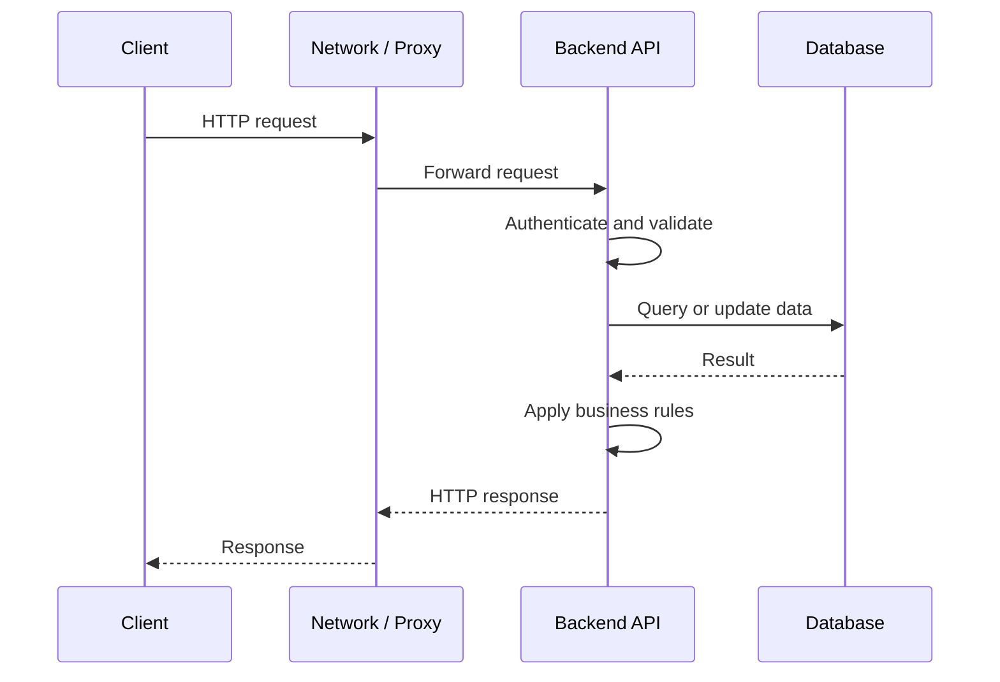
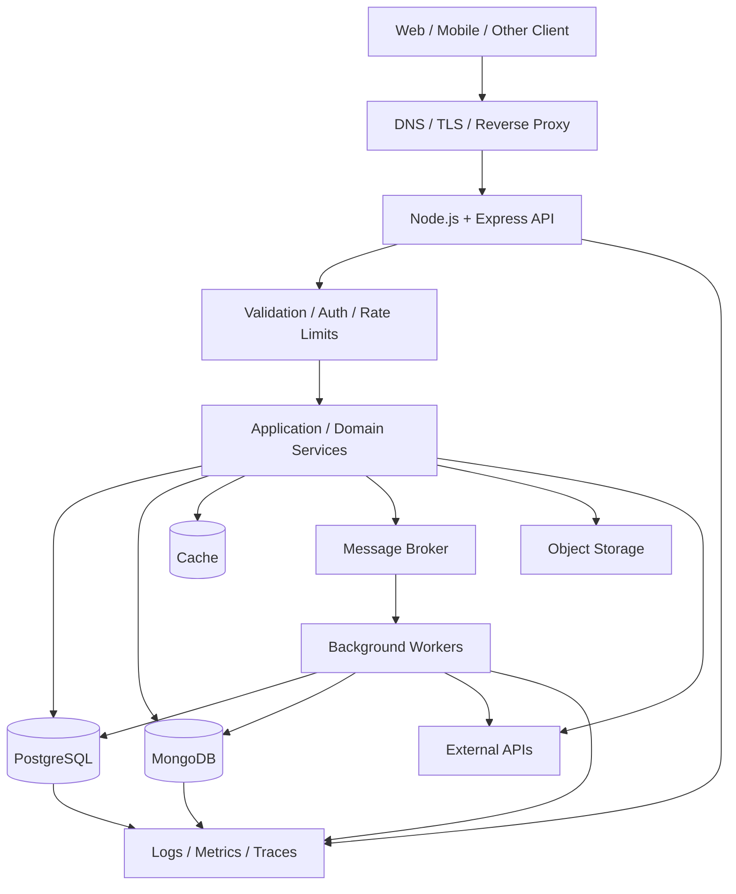
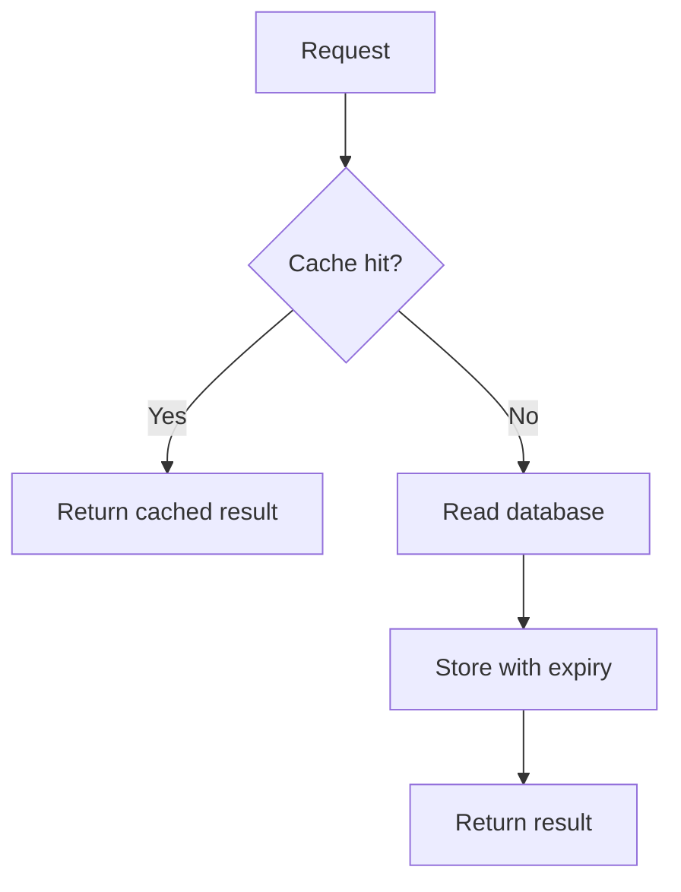
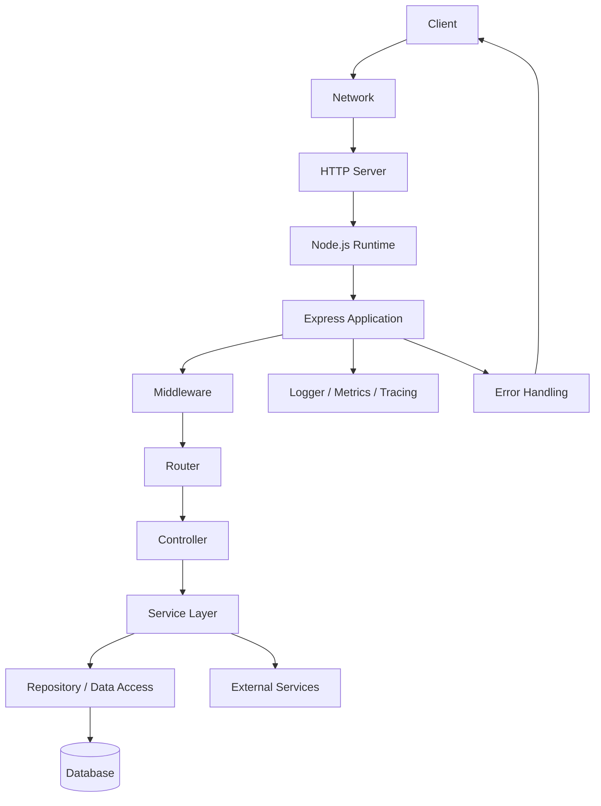
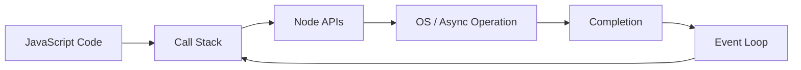
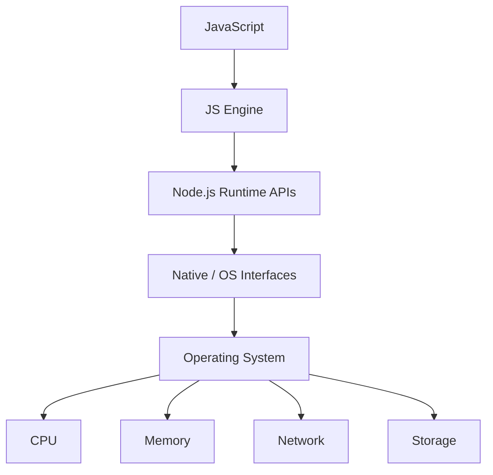

<p align="center">
  
  
  
  
</p>

<h1 align="center">Backend Development Mastery</h1>

<p align="center">
  A comprehensive, research-oriented curriculum for building, securing, testing, scaling, and operating backend systems—from first principles to production architecture.
</p>

---

# 👨‍💻 About Me

Hi, I'm **Satinder Singh Sall**, a Full-Stack Developer, AI Enthusiast, and MCA student passionate about building scalable digital products, intelligent software systems, and meaningful user experiences.

My journey spans across **Web Development, Mobile Applications, Artificial Intelligence, Cloud Technologies, and Creative Writing**. I enjoy transforming ideas into production-ready solutions using modern technologies while continuously exploring emerging fields like Machine Learning, Computer Vision, and Automation.

Currently, I'm pursuing my **Master of Computer Applications (MCA)** while actively developing full-stack applications, AI-powered solutions, and open-source learning resources. My work focuses on creating software that is not only functional but also scalable, maintainable, and impactful.

## 🚀 What I'm Building

- 🤖 AI-Powered Attendance System using Face Recognition & Voice Biometrics
- 🌐 Modern Full-Stack Web Applications
- 📱 Cross-Platform Mobile Applications
- 🎮 Exploring Game Development & Interactive Experiences
- 📚 Open-Source Learning Roadmaps and Technical Resources
- ✍️ Satinder Poetry — A platform for original poetry, essays, and creative writing

## 🛠️ Core Technologies

**Frontend:** React, Next.js, TypeScript, Tailwind CSS
**Backend:** Node.js, Express.js, REST APIs
**Databases:** MongoDB, PostgreSQL, MySQL, Firebase, Supabase
**DevOps & Cloud:** Docker, GitHub Actions, Vercel, Render
**Programming:** Python, Java, JavaScript, C++, C#, Kotlin
**AI / ML:** Python, Computer Vision, Face Recognition, Automation
**Mobile Apps:** High-Performance Android, iOS, Cross-Platform & Native Development

## 🌍 Connect With Me

🌐 Portfolio: https://satinder-portfolio.vercel.app

💻 GitHub: https://github.com/SatinderSinghSall

💼 LinkedIn: https://www.linkedin.com/in/satinder-singh-sall-b62049204/

🎥 YouTube: https://www.youtube.com/@satindersinghsall.3841

✍️ Satinder Poetry: https://satinderpoetry.com

🤖 AI Attendance Project: https://ai-attendance-app-satinder.vercel.app/

---

> _"I believe great software is built at the intersection of engineering excellence, continuous learning, creativity, and real-world problem solving."_

⭐ Always learning. Always building. Always improving.

---

<p align="center">
  <a href="https://nodejs.org/"></a>
  <a href="https://expressjs.com/"></a>
  <a href="https://www.mongodb.com/docs/"></a>
  <a href="https://www.postgresql.org/docs/"></a>
  <a href="https://owasp.org/www-project-top-ten/"></a>
  <a href="https://opentelemetry.io/docs/"></a>
  <a href="https://opensource.org/licenses/MIT"></a>
</p>

<p align="center">
  <strong>Fundamentals → Backend Programming → APIs → Databases → Security → Testing → Performance → Architecture → Distributed Systems → Research</strong>
</p>

---

## Table of Contents

- [Abstract](#abstract)
- [Learning Philosophy](#learning-philosophy)
- [Learning Outcomes](#learning-outcomes)
- [Prerequisites](#prerequisites)
- [Backend Development Overview](#backend-development-overview)
- [System Architecture](#system-architecture)
- [Technology Stack](#technology-stack)
- [Complete Learning Roadmap](#complete-learning-roadmap)
  - [01. Computer and Web Fundamentals](#01-computer-and-web-fundamentals)
  - [02. Git, Linux and Developer Workflow](#02-git-linux-and-developer-workflow)
  - [03. JavaScript Fundamentals](#03-javascript-fundamentals)
  - [04. Advanced JavaScript and TypeScript](#04-advanced-javascript-and-typescript)
  - [05. Node.js Runtime and Core APIs](#05-nodejs-runtime-and-core-apis)
  - [06. Asynchronous Programming and Concurrency](#06-asynchronous-programming-and-concurrency)
  - [07. HTTP, Networking and Web Protocols](#07-http-networking-and-web-protocols)
  - [08. Express and Backend Frameworks](#08-express-and-backend-frameworks)
  - [09. REST API Engineering](#09-rest-api-engineering)
  - [10. API Validation, Documentation and Contracts](#10-api-validation-documentation-and-contracts)
  - [11. Relational Database Fundamentals](#11-relational-database-fundamentals)
  - [12. SQL from Fundamentals to Advanced](#12-sql-from-fundamentals-to-advanced)
  - [13. PostgreSQL Engineering](#13-postgresql-engineering)
  - [14. MongoDB and Document Database Engineering](#14-mongodb-and-document-database-engineering)
  - [15. Data Modeling and Database Architecture](#15-data-modeling-and-database-architecture)
  - [16. Database Performance and Internals](#16-database-performance-and-internals)
  - [17. Authentication and Authorization](#17-authentication-and-authorization)
  - [18. Backend Security Engineering](#18-backend-security-engineering)
  - [19. Testing and Quality Engineering](#19-testing-and-quality-engineering)
  - [20. Caching and Performance Engineering](#20-caching-and-performance-engineering)
  - [21. Background Jobs and Messaging](#21-background-jobs-and-messaging)
  - [22. Real-Time and Event-Driven Systems](#22-real-time-and-event-driven-systems)
  - [23. File Handling and External Integrations](#23-file-handling-and-external-integrations)
  - [24. Backend Architecture and Design Patterns](#24-backend-architecture-and-design-patterns)
  - [25. Distributed Systems and Resilience](#25-distributed-systems-and-resilience)
  - [26. Observability and Production Operations](#26-observability-and-production-operations)
  - [27. Containers, CI/CD and Deployment](#27-containers-cicd-and-deployment)
  - [28. Cloud, Scaling and Infrastructure](#28-cloud-scaling-and-infrastructure)
  - [29. Performance Research and Benchmarking](#29-performance-research-and-benchmarking)
  - [30. Advanced Capstone Projects](#30-advanced-capstone-projects)
- [Data Structures and Algorithms](#data-structures-and-algorithms)
- [Database Deep-Dive Checklist](#database-deep-dive-checklist)
- [Professional Backend Workflow](#professional-backend-workflow)
- [Repository Structure](#repository-structure)
- [Progress Tracker](#progress-tracker)
- [Mastery Levels](#mastery-levels)
- [Interview Preparation](#interview-preparation)
- [Common Mistakes](#common-mistakes)
- [Research Methodology](#research-methodology)
- [References](#references)
- [Final Learning Objective](#final-learning-objective)

---

## Abstract

Backend development is the engineering discipline concerned with application behavior outside the user's interface: business rules, data persistence, APIs, identity, authorization, integrations, asynchronous work, reliability, deployment, and operational visibility. A backend service must do more than return a successful response. It must preserve data correctness, enforce security boundaries, handle failures, perform predictably under load, and remain maintainable as requirements change.

This curriculum builds a connected understanding of the backend stack. It begins with computer, web, programming, and developer-tool fundamentals; progresses through JavaScript, TypeScript, Node.js, HTTP, Express, and API design; then studies relational and document databases as first-class engineering disciplines. SQL, schema design, indexes, transactions, isolation, MongoDB document modeling, aggregation, replication, and database performance are treated as distinct skills rather than a brief database integration step.

The later stages cover authentication, authorization, security engineering, automated testing, caching, background jobs, messaging, real-time communication, architecture, distributed systems, resilience, observability, containers, CI/CD, cloud deployment, scaling, and research-oriented benchmarking. Each area connects theory to implementation through exercises, labs, project milestones, and mastery checklists.

The recommended primary learning stack is JavaScript/TypeScript, Node.js, Express, PostgreSQL, and MongoDB. The aim is not to learn every tool simultaneously or assume one stack fits every problem. Instead, the learner should understand the responsibilities and trade-offs behind each component, then select technologies deliberately.

The curriculum follows an evidence-based engineering loop: understand the model, implement a small example, test expected and failure behavior, debug with tools, measure the result, improve it, and document the design. Security, testing, database correctness, and operational behavior are continuous requirements, not final polish. The advanced stages introduce reproducible experiments so architectural and performance decisions can be evaluated with evidence.

By the end, the learner should be able to design, build, verify, secure, deploy, observe, and evolve a backend system—and explain the reasons, assumptions, limitations, and trade-offs behind the implementation.

---

## Learning Philosophy

```text
Understand
    ↓
Implement
    ↓
Test
    ↓
Debug
    ↓
Measure
    ↓
Optimize
    ↓
Secure
    ↓
Design
    ↓
Operate
    ↓
Research
```

- **Understand:** Learn the underlying protocol, runtime, data model, and constraints.
- **Implement:** Build small examples before introducing complex abstractions.
- **Test:** Verify expected results, boundary conditions, invalid input, and failures.
- **Debug:** Reproduce issues and use logs, debuggers, traces, and database plans.
- **Measure:** Collect latency, throughput, error rate, resource usage, and query behavior.
- **Optimize:** Improve a measured bottleneck without sacrificing correctness.
- **Secure:** Treat all external input, identity claims, dependencies, and trust boundaries as risks.
- **Design:** Choose a system structure based on requirements and trade-offs.
- **Operate:** Deploy, monitor, recover, and maintain the service.
- **Research:** Form hypotheses and conduct controlled, reproducible experiments.

---

## Learning Outcomes

A learner who completes the curriculum should be able to:

- Explain the client-server model, DNS, TCP/IP, TLS, HTTP, and browser-to-server request flow.
- Use Git, command-line tools, environment variables, and a debugger.
- Write maintainable JavaScript and TypeScript.
- Explain Node.js runtime behavior and asynchronous execution.
- Build HTTP services with Express.
- Design REST APIs with consistent semantics, validation, pagination, and error formats.
- Document APIs using OpenAPI.
- Design normalized relational schemas and document-oriented data models.
- Write SQL joins, subqueries, CTEs, window functions, and transactions.
- Use PostgreSQL constraints, indexes, migrations, and query plans.
- Use MongoDB CRUD, aggregation, indexes, schema validation, and appropriate data modeling.
- Explain ACID properties, isolation anomalies, locking, consistency, and transaction boundaries.
- Evaluate when relational, document, key-value, search, or analytical storage is appropriate.
- Build authentication and authorization flows.
- Apply secure password storage, session/token handling, access control, and rate limits.
- Test units, database integration, APIs, contracts, and end-to-end behavior.
- Diagnose database and application bottlenecks using measurements.
- Apply caching, queues, workers, and event-driven processing when appropriate.
- Design reliable integrations with external services.
- Apply modular architecture and recognize when distributed services add unnecessary complexity.
- Handle timeouts, retries, idempotency, backpressure, and graceful shutdown.
- Containerize and deploy backend applications.
- Use structured logs, metrics, traces, health checks, and service-level objectives.
- Automate quality checks and delivery using CI/CD.
- Conduct controlled performance experiments and communicate limitations.
- Build portfolio projects with architecture, testing, security, deployment, and operations documentation.

---

## Prerequisites

### Beginner

- Basic computer literacy.
- Ability to install software and navigate directories.
- Familiarity with files, folders, and command-line commands.
- No prior backend experience required.

### Intermediate

- Basic programming concepts.
- JavaScript variables, functions, arrays, and objects.
- JSON syntax.
- Basic Git commands.
- Basic SQL or database concepts are helpful but can be learned in this roadmap.

### Advanced

- Asynchronous programming.
- HTTP and networking basics.
- Database constraints and transactions.
- Basic data structures and algorithm analysis.
- Command-line comfort.
- Basic understanding of processes, ports, and environment variables.

---

# Backend Development Overview

## What is a backend?

A backend is the part of an application that processes requests, applies business rules, manages identity and permissions, stores or retrieves data, integrates with other systems, and returns results.

A backend may be a single deployable application or a collection of services. It may expose HTTP APIs, consume messages, run scheduled tasks, or provide real-time communication.

## Typical responsibilities

| Area                  | Responsibility                          |
| --------------------- | --------------------------------------- |
| API layer             | Receives requests and returns responses |
| Business logic        | Enforces application rules              |
| Identity              | Establishes who a user or service is    |
| Authorization         | Determines what the identity may do     |
| Persistence           | Stores and retrieves application state  |
| Integration           | Communicates with external services     |
| Background processing | Performs deferred or scheduled work     |
| Security              | Protects data and operations            |
| Observability         | Makes runtime behavior measurable       |
| Delivery              | Builds, deploys, and updates software   |

## A request lifecycle



A real request may also use caches, message brokers, identity providers, object storage, and other services. Each added dependency introduces latency, operational cost, and possible failure modes.

---

# System Architecture



### Architecture principles

- A database is not merely a place to save objects; it is part of the system's correctness model.
- Authentication and authorization are different responsibilities.
- A successful HTTP response does not guarantee a business operation was correct.
- A retry can duplicate a side effect unless the operation is designed to be idempotent.
- Caching improves some workloads but creates invalidation and consistency questions.
- Microservices are a trade-off, not an automatic sign of maturity.
- Every dependency should have a reason, an owner, failure handling, and operational visibility.

---

# Technology Stack

This roadmap uses a recommended learning stack, not a mandatory universal standard.

| Layer               | Primary option                                | What to learn                                  |
| ------------------- | --------------------------------------------- | ---------------------------------------------- |
| Language            | JavaScript, then TypeScript                   | Types, modules, asynchronous code              |
| Runtime             | Node.js LTS                                   | Core APIs, event loop, diagnostics             |
| Web framework       | Express                                       | Routing, middleware, errors                    |
| Relational database | PostgreSQL                                    | SQL, constraints, transactions, query plans    |
| Document database   | MongoDB                                       | Documents, aggregation, indexes, schema design |
| Data access         | Native drivers first; ORM/ODM when useful     | Boundaries, query behavior, migrations         |
| API contract        | OpenAPI                                       | Documentation and contract validation          |
| Testing             | Node test runner or a chosen test framework   | Unit, integration, API testing                 |
| API exploration     | curl, Postman or equivalent                   | Request/response inspection                    |
| Cache               | Redis or equivalent                           | TTLs, eviction, invalidation                   |
| Messaging           | A queue or broker appropriate to the use case | Delivery, retries, ordering                    |
| Observability       | OpenTelemetry-compatible tools                | Logs, metrics, traces                          |
| Containers          | Docker                                        | Images, networking, volumes                    |
| CI/CD               | GitHub Actions or equivalent                  | Automated checks and deployments               |
| Deployment          | A cloud or managed platform                   | Networking, secrets, scaling, operations       |

**Study rule:** learn the problem a tool solves before learning its configuration.

---

# Complete Learning Roadmap

Each stage includes objectives, concepts, practical work, a lab, mistakes to avoid, and a mastery checklist. Complete the labs before moving to the next major topic.

---

# 01. Computer and Web Fundamentals

## Learning Objectives

Understand the path from a client action to a backend response.

## Core Concepts

- Client-server architecture.
- Operating systems, processes, and threads.
- Filesystems and permissions.
- IP addresses and ports.
- DNS resolution.
- TCP and UDP at a conceptual level.
- TLS and certificates.
- HTTP request/response.
- URLs, headers, methods, status codes.
- JSON and serialization.
- Environment variables.
- Standard input, output, and error streams.

## Theory

A URL identifies a resource and may include a scheme, host, port, path, query, and fragment. DNS helps resolve hostnames; TCP provides a reliable byte stream; TLS protects communication when correctly configured; HTTP defines request/response semantics.

Do not confuse a hostname with an IP address, a port with a process, or a route with a physical file path.

## Example

```http
GET /api/products?limit=10 HTTP/1.1
Host: localhost:3000
Accept: application/json
```

## Exercises

1. Identify the parts of five URLs.
2. Inspect HTTP response headers.
3. Compare 200, 201, 400, 401, 403, 404, 409, 429, and 500.
4. Explain what a port is and why two processes cannot normally bind the same address/port combination.

## Lab

Use `curl` or an API client to request a public endpoint. Record its method, URL, status, headers, body, and timing.

## Common Mistakes

- Treating HTTP as a database protocol.
- Confusing authentication with authorization.
- Assuming all network failures are immediate.
- Ignoring status codes and headers.

## Interview Questions

- What happens after entering a URL?
- What are DNS, TCP, and TLS?
- What is the difference between a port and an IP address?
- What does stateless HTTP mean?

## Mastery Checklist

- [ ] Explain client-server communication
- [ ] Inspect an HTTP exchange
- [ ] Understand ports and processes
- [ ] Explain DNS and TLS conceptually
- [ ] Diagnose a basic connectivity problem

---

# 02. Git, Linux and Developer Workflow

## Learning Objectives

Work safely and reproducibly in a development environment.

## Core Concepts

- Git repositories, commits, branches, merges.
- `.gitignore`.
- Pull requests and code review.
- Command-line navigation.
- Paths and permissions.
- Processes and signals.
- Environment variables.
- Shell quoting.
- Exit codes.
- Package managers.
- VS Code debugging.
- Terminal differences across PowerShell, Command Prompt, Git Bash, and Unix shells.

## Example

```bash
git init
git add .
git commit -m "chore: initialize backend project"
```

## Practical Skills

- Inspect process output.
- Find files.
- Read logs.
- Set environment variables.
- Use `curl`.
- Debug a running Node.js process.
- Diagnose PATH issues when a command works in one terminal but not another.

## Lab

Create a repository, make a branch, implement a small feature, merge it, and document the workflow.

## Common Mistakes

- Committing `.env` files.
- Ignoring merge conflicts.
- Running commands from the wrong directory.
- Assuming shell commands are identical across operating systems.

## Mastery Checklist

- [ ] Use Git confidently
- [ ] Navigate from the terminal
- [ ] Understand environment variables
- [ ] Inspect processes and exit codes
- [ ] Debug basic environment problems

---

# 03. JavaScript Fundamentals

## Learning Objectives

Build the language foundation needed for backend programming.

## Core Concepts

- `let`, `const`, and scope.
- Primitive values and object references.
- Operators and coercion.
- Conditions and loops.
- Functions and arrow functions.
- Arrays and objects.
- Destructuring and spread/rest.
- Template literals.
- Scope and closures.
- `this`.
- Exceptions.
- JSON.
- Array methods.
- Map and Set.
- Modules.

## Example

```js
function summarizeOrders(orders) {
  return orders
    .filter((order) => order.status === "paid")
    .reduce((total, order) => total + order.amount, 0);
}
```

## Exercises

- Implement array transformations.
- Write input validation functions.
- Convert data between objects and JSON.
- Practice scope and closure examples.
- Build a small command-line record manager.

## Lab

Read records from JSON, validate them, calculate summaries, and write a report to a new file.

## Common Mistakes

- Using loose equality without understanding coercion.
- Mutating shared objects unintentionally.
- Confusing `undefined` with `null`.
- Ignoring exceptions.
- Writing overly complex functions.

## Mastery Checklist

- [ ] Explain types and references
- [ ] Use functions and modules
- [ ] Transform arrays and objects
- [ ] Handle errors
- [ ] Write readable code
- [ ] Test edge cases

---

# 04. Advanced JavaScript and TypeScript

## Learning Objectives

Write safer, more maintainable backend code and understand advanced language behavior.

## Core Concepts

- Closures and lexical scope.
- Prototypes and inheritance.
- Classes and composition.
- Iterators and generators.
- Promises and async functions.
- Event emitters.
- Symbols.
- WeakMap and WeakSet.
- Error types.
- TypeScript annotations.
- Interfaces and type aliases.
- Union and intersection types.
- Generics.
- Narrowing and discriminated unions.
- Utility types.
- Runtime validation vs compile-time types.
- Compiler configuration.

## Theory

TypeScript catches many mistakes before runtime, but its types do not automatically validate incoming HTTP data. Data crossing a network or persistence boundary still requires runtime validation.

## Example

```ts
type ApiResult<T> =
  | { ok: true; data: T }
  | { ok: false; error: { code: string; message: string } };

function unwrap<T>(result: ApiResult<T>): T {
  if (!result.ok) {
    throw new Error(result.error.message);
  }
  return result.data;
}
```

## Lab

Convert a small JavaScript API module to TypeScript. Add explicit types to request DTOs, service boundaries, and database results, while keeping runtime validation at external boundaries.

## Common Mistakes

- Using `any` to silence every type error.
- Assuming a TypeScript type validates runtime JSON.
- Overusing inheritance.
- Confusing compile-time checks with runtime guarantees.

## Mastery Checklist

- [ ] Explain advanced JavaScript behavior
- [ ] Use TypeScript types effectively
- [ ] Model success and failure explicitly
- [ ] Validate external data at runtime
- [ ] Avoid unnecessary type complexity

---

# 05. Node.js Runtime and Core APIs

## Learning Objectives

Understand the runtime and use core APIs directly.

## Core Concepts

- Node.js LTS releases.
- V8 at a high level.
- `process`.
- `fs`.
- `path`.
- `url`.
- `events`.
- `http` and `https`.
- `crypto`.
- `buffer`.
- `stream`.
- `timers`.
- `child_process`.
- `worker_threads`.
- Environment configuration.
- Graceful shutdown.

## Example: Native HTTP Server

```js
const http = require("node:http");

const server = http.createServer((req, res) => {
  res.writeHead(200, { "content-type": "application/json" });
  res.end(JSON.stringify({ status: "ok" }));
});

server.listen(3000, () => {
  console.log("Listening on port 3000");
});
```

## Theory

Express is an abstraction built on Node.js HTTP capabilities. Learning the native layer helps explain request lifecycles, streams, sockets, and server behavior.

## Lab

Build a native HTTP server with a health endpoint, JSON response, 404 response, and graceful shutdown.

## Common Mistakes

- Performing expensive synchronous file operations per request.
- Ignoring stream backpressure.
- Treating buffers as ordinary strings.
- Exiting immediately without closing resources.

## Mastery Checklist

- [ ] Use core APIs
- [ ] Build a native HTTP server
- [ ] Work with files and streams
- [ ] Read environment variables safely
- [ ] Handle shutdown signals

---

# 06. Asynchronous Programming and Concurrency

## Learning Objectives

Reason correctly about asynchronous work and concurrent requests.

## Core Concepts

- Call stack.
- Event loop.
- Promises.
- `async`/`await`.
- Microtasks and timers.
- Callback APIs.
- Non-blocking I/O.
- Concurrency vs parallelism.
- Event-loop blocking.
- Worker threads and child processes.
- Race conditions.
- Cancellation and timeouts.
- Stream backpressure.

## Example

```js
async function loadUserAndOrders(userId) {
  const userPromise = getUser(userId);
  const ordersPromise = getOrders(userId);

  const [user, orders] = await Promise.all([userPromise, ordersPromise]);

  return { user, orders };
}
```

Use `Promise.all` only when the operations can safely run concurrently and their failure semantics are acceptable.

## Lab

Create two endpoints: one performs CPU-heavy synchronous work; the other responds immediately. Send concurrent requests and measure how the first affects the second.

## Common Mistakes

- Forgetting to await a Promise.
- Creating unbounded concurrent operations.
- Using parallel execution for dependent operations.
- Assuming async code automatically uses multiple CPU cores.

## Mastery Checklist

- [ ] Explain the event loop
- [ ] Handle Promise failures
- [ ] Use concurrency deliberately
- [ ] Identify event-loop blocking
- [ ] Apply timeouts and cancellation where appropriate

---

# 07. HTTP, Networking and Web Protocols

## Learning Objectives

Understand the protocol behavior that backend APIs depend on.

## Core Concepts

- HTTP methods and status codes.
- Headers and content types.
- Cookies.
- CORS.
- TLS.
- HTTP/1.1, HTTP/2, and HTTP/3 at a conceptual level.
- Keep-alive.
- Reverse proxies.
- Forwarded headers.
- WebSockets.
- Server-sent events.
- DNS and connection failures.
- Compression.
- Request size limits.

## Theory

HTTP method semantics affect caching, retries, idempotency, and client expectations. Proxy configuration also affects client IP interpretation, TLS termination, and secure-cookie behavior.

## Lab

Inspect the same API request directly and through a reverse proxy. Compare headers, connection behavior, latency, and error responses.

## Mastery Checklist

- [ ] Explain common HTTP methods
- [ ] Choose appropriate status codes
- [ ] Understand CORS
- [ ] Understand TLS termination
- [ ] Inspect proxy-related behavior
- [ ] Diagnose common network failures

---

# 08. Express and Backend Frameworks

## Learning Objectives

Build maintainable HTTP services using Express and understand the role of a framework.

## Core Concepts

- Application setup.
- Routers.
- Middleware.
- Route parameters.
- Query parameters.
- Request body parsing.
- Error middleware.
- Request lifecycle.
- Configuration.
- Controller/service separation.
- Graceful shutdown.
- Framework version compatibility.

## Example

```js
const express = require("express");

const app = express();
app.use(express.json({ limit: "1mb" }));

app.get("/health", (req, res) => {
  res.status(200).json({ status: "ok" });
});

app.listen(3000);
```

## Recommended Structure

```text
src/
├── app.js
├── server.js
├── routes/
├── controllers/
├── services/
├── repositories/
├── middleware/
├── validators/
├── config/
└── utils/
```

## Lab

Build a CRUD API with routers, controllers, validation middleware, centralized error handling, and tests.

## Common Mistakes

- Incorrect middleware order.
- Sending more than one response.
- Putting all business logic in routes.
- Exposing internal error details.
- Ignoring the framework's version-specific error behavior.

## Mastery Checklist

- [ ] Build Express routes
- [ ] Compose middleware
- [ ] Separate application responsibilities
- [ ] Handle errors consistently
- [ ] Test routes and middleware

---

# 09. REST API Engineering

## Learning Objectives

Design stable APIs that are predictable for clients.

## Core Concepts

- Resource-oriented URLs.
- HTTP method semantics.
- Status codes.
- Pagination.
- Filtering and sorting.
- Search.
- Idempotency.
- Versioning.
- Error envelopes.
- Partial updates.
- Concurrency control.
- Rate limiting.
- Backward compatibility.

## Example Resource Design

```text
GET    /api/v1/products
GET    /api/v1/products/:id
POST   /api/v1/products
PATCH  /api/v1/products/:id
DELETE /api/v1/products/:id
```

## Lab

Write an API contract before implementation. Define request schemas, response schemas, error cases, pagination, and status codes.

## Mastery Checklist

- [ ] Design resource URLs
- [ ] Use HTTP semantics correctly
- [ ] Implement pagination
- [ ] Define consistent errors
- [ ] Design idempotent operations
- [ ] Consider API evolution

---

# 10. API Validation, Documentation and Contracts

## Learning Objectives

Make API expectations explicit and testable.

## Core Concepts

- Runtime validation.
- DTOs.
- Schema validation.
- OpenAPI.
- Request/response contracts.
- API versioning.
- Contract tests.
- Error documentation.
- Deprecation policy.
- Generated clients and their limitations.

## Example Validation Principle

Treat all request data as untrusted, including:

- Path parameters.
- Query parameters.
- JSON bodies.
- Headers.
- Uploaded files.
- Webhook payloads.

Validate shape, type, range, length, and business rules.

## Lab

Create an OpenAPI document for the CRUD API. Validate requests, document responses, and add contract tests for critical endpoints.

## Mastery Checklist

- [ ] Validate all external input
- [ ] Document endpoints
- [ ] Specify errors
- [ ] Test contracts
- [ ] Plan backward-compatible changes

---

# 11. Relational Database Fundamentals

## Learning Objectives

Understand relational modeling and the correctness guarantees of relational databases.

## Core Concepts

- Database, schema, table, row, column.
- Primary keys.
- Foreign keys.
- Unique and check constraints.
- Normalization.
- Relationships.
- Transactions.
- ACID.
- Isolation levels.
- Locks.
- Indexes.
- Migrations.
- Backups and restore.

## Theory

A database constraint protects data integrity at the persistence boundary. Application validation improves feedback, but it should not be the only protection against invalid data when the database can enforce the rule.

## Example Schema

```sql
CREATE TABLE users (
  id BIGINT GENERATED ALWAYS AS IDENTITY PRIMARY KEY,
  email TEXT NOT NULL UNIQUE,
  created_at TIMESTAMPTZ NOT NULL DEFAULT now()
);

CREATE TABLE orders (
  id BIGINT GENERATED ALWAYS AS IDENTITY PRIMARY KEY,
  user_id BIGINT NOT NULL REFERENCES users(id),
  total_cents BIGINT NOT NULL CHECK (total_cents >= 0),
  created_at TIMESTAMPTZ NOT NULL DEFAULT now()
);
```

## Lab

Design a small order-management schema. Add keys and constraints, insert invalid data intentionally, and verify the database rejects it.

## Mastery Checklist

- [ ] Model entities and relationships
- [ ] Use keys and constraints
- [ ] Explain normalization
- [ ] Explain ACID
- [ ] Create and reverse migrations safely
- [ ] Practice backup and restore

---

# 12. SQL from Fundamentals to Advanced

## Learning Objectives

Write correct, maintainable, and efficient SQL.

## Beginner

- `SELECT`
- `INSERT`
- `UPDATE`
- `DELETE`
- `WHERE`
- `ORDER BY`
- `LIMIT`
- `NULL`
- Aggregate functions.

## Intermediate

- Inner and outer joins.
- `GROUP BY` and `HAVING`.
- Subqueries.
- CTEs.
- `CASE`.
- Set operations.
- Constraints.
- Transactions.
- Prepared statements.

## Advanced

- Window functions.
- Recursive CTEs.
- Query plans.
- Index-aware query design.
- Locking.
- Isolation anomalies.
- Upserts.
- Keyset pagination.
- Partitioning concepts.
- Query optimization.

## Example: Window Function

```sql
SELECT
  user_id,
  id AS order_id,
  total_cents,
  ROW_NUMBER() OVER (
    PARTITION BY user_id
    ORDER BY created_at DESC
  ) AS order_rank
FROM orders;
```

## Exercises

- Find each user's latest order.
- Calculate monthly revenue.
- Detect duplicate records.
- Compare offset and keyset pagination.
- Write a transaction that preserves an invariant.

## Lab

Use `EXPLAIN` (and where appropriate `EXPLAIN ANALYZE`) to compare a query before and after an index change. Be aware that `EXPLAIN ANALYZE` executes the query.

## Mastery Checklist

- [ ] Write joins
- [ ] Use aggregates and CTEs
- [ ] Use window functions
- [ ] Understand NULL semantics
- [ ] Use transactions correctly
- [ ] Read query plans
- [ ] Optimize based on evidence

---

# 13. PostgreSQL Engineering

## Learning Objectives

Operate PostgreSQL beyond basic SQL queries.

## Core Concepts

- Installation and connection.
- Roles and privileges.
- Schemas.
- Data types.
- Constraints.
- Index types and trade-offs.
- B-tree indexes.
- Composite indexes.
- Partial indexes.
- Expression indexes.
- Transactions and isolation.
- MVCC conceptually.
- Locks and deadlocks.
- Connection pooling.
- Migrations.
- JSONB.
- Full-text search.
- Backup and restore.
- Replication and partitioning concepts.

## Data Modeling

Choose types intentionally:

- Use appropriate numeric types for money and counts.
- Use timestamps with clear timezone semantics.
- Use foreign keys where relational integrity is required.
- Add uniqueness and check constraints for enforceable invariants.
- Avoid adding indexes without considering write cost and storage.

## Lab

Build a transactional order workflow:

1. Create an order.
2. Insert order items.
3. Update inventory with appropriate concurrency protection.
4. Commit only if all required operations succeed.
5. Test concurrent purchases and failure rollback.

## Common Mistakes

- Treating every query as equally fast.
- Over-indexing write-heavy tables.
- Ignoring connection-pool limits.
- Assuming a transaction automatically solves every concurrency issue.
- Deploying destructive schema changes without a migration strategy.

## Mastery Checklist

- [ ] Design relational schemas
- [ ] Create useful indexes
- [ ] Read query plans
- [ ] Explain transactions and isolation
- [ ] Diagnose locks and deadlocks
- [ ] Configure connection pooling
- [ ] Back up and restore data

---

# 14. MongoDB and Document Database Engineering

## Learning Objectives

Model and query document data while understanding the trade-offs from relational design.

## Core Concepts

- Documents and collections.
- BSON types.
- Object IDs.
- CRUD operations.
- Query filters.
- Projection.
- Sorting and pagination.
- Embedded vs referenced data.
- Schema validation.
- Indexes.
- Compound indexes.
- Unique indexes.
- Aggregation pipeline.
- Atomic document updates.
- Transactions.
- Replication.
- Sharding concepts.
- Change streams.
- Backup and restore.
- Driver and ODM behavior.

## Example Document

```json
{
  "_id": "example-id",
  "customerId": "customer-123",
  "status": "paid",
  "items": [
    {
      "productId": "product-9",
      "quantity": 2,
      "unitPriceCents": 1250
    }
  ],
  "createdAt": "2026-01-15T10:00:00.000Z"
}
```

This is illustrative data, not a recommendation to store every relationship in this shape. Model around access patterns, update boundaries, consistency requirements, and growth.

## Aggregation Concepts

- `$match`
- `$project`
- `$group`
- `$sort`
- `$unwind`
- `$lookup`
- `$limit`
- `$facet`

## Lab

Build a product/order API using MongoDB. Compare an embedded design with a referenced design for a chosen query and update workload. Record read patterns, write complexity, document growth, and consistency implications.

## Common Mistakes

- Treating MongoDB as a relational database with tables renamed.
- Embedding unbounded arrays.
- Adding indexes without measuring.
- Ignoring schema validation.
- Assuming a transaction removes the need for data modeling.
- Using an ODM without understanding the queries it generates.

## Mastery Checklist

- [ ] Perform CRUD operations
- [ ] Model embedded and referenced data
- [ ] Build aggregation pipelines
- [ ] Create and inspect indexes
- [ ] Validate document shape
- [ ] Explain atomicity and transaction trade-offs
- [ ] Back up and restore data

---

# 15. Data Modeling and Database Architecture

## Learning Objectives

Choose storage models based on invariants, access patterns, consistency, and operational constraints.

## Core Concepts

- Domain entities.
- Relationships.
- Normalization and denormalization.
- Aggregate boundaries.
- Referential integrity.
- Read/write patterns.
- Transaction boundaries.
- Relational vs document modeling.
- Polyglot persistence.
- Data ownership.
- Schema evolution.
- Data retention.
- Archival.
- Migration strategies.

## Decision Questions

Before choosing a database, ask:

1. What data invariants must always hold?
2. Which queries dominate the workload?
3. Which updates must be atomic?
4. How are relationships traversed?
5. How does the data grow?
6. What are the consistency requirements?
7. What operational skills and tooling are available?

## Lab

Model the same small domain in PostgreSQL and MongoDB. Implement three representative reads and two writes in each. Compare complexity, constraints, query behavior, and maintenance.

## Mastery Checklist

- [ ] Identify domain entities
- [ ] Model relationships
- [ ] Explain normalization and denormalization
- [ ] Match indexes to queries
- [ ] Plan schema evolution
- [ ] Justify a storage choice with evidence

---

# 16. Database Performance and Internals

## Learning Objectives

Diagnose slow queries and understand database resource behavior.

## Core Concepts

- Query planner.
- Execution plans.
- Selectivity and cardinality.
- Index scans and sequential scans.
- Composite-index ordering.
- Statistics.
- Buffer/cache behavior.
- Lock contention.
- Connection pools.
- Transactions and long-running queries.
- Replication lag.
- Write amplification.
- Database metrics.
- Slow query logs.

## Methodology

```text
Identify Slow Operation
        ↓
Capture Query and Parameters
        ↓
Inspect Query Plan
        ↓
Check Indexes and Statistics
        ↓
Measure Under Representative Data
        ↓
Change One Variable
        ↓
Re-measure and Verify Correctness
```

## Lab

Create a dataset large enough to make query behavior observable. Compare:

- Indexed and unindexed filters.
- Offset and keyset pagination.
- One query vs repeated per-row queries.
- Different pool sizes under concurrent load.

## Research Questions

- How does table size affect query planning?
- How does index selectivity influence latency?
- When does connection pooling become a bottleneck?
- How does write load affect read latency?

## Mastery Checklist

- [ ] Capture slow queries
- [ ] Read query plans
- [ ] Identify missing or ineffective indexes
- [ ] Understand lock contention
- [ ] Measure pool behavior
- [ ] Compare performance under realistic data

---

# 17. Authentication and Authorization

## Learning Objectives

Build identity and access-control systems with explicit security boundaries.

## Core Concepts

- Authentication vs authorization.
- Password hashing.
- Sessions.
- Cookies.
- Access and refresh tokens.
- JWT structure and limitations.
- Token expiry and revocation.
- OAuth 2.0 and OpenID Connect concepts.
- Role-based access control.
- Attribute-based access control.
- Resource ownership.
- Multi-factor authentication concepts.
- Password reset.
- Account verification.
- Audit events.

## Security Principles

- Store password hashes using an appropriate password-hashing algorithm and configuration; never store plaintext passwords.
- Do not treat a decoded JWT as trusted until its signature and relevant claims have been verified.
- Define token expiry, revocation, storage, and refresh behavior.
- Check authorization on every protected operation, including object-level access.
- Avoid leaking whether a sensitive account exists when the threat model requires uniform responses.

## Lab

Implement registration, login, protected routes, ownership checks, logout/revocation behavior, and security tests.

## Mastery Checklist

- [ ] Implement password hashing
- [ ] Choose a session or token strategy
- [ ] Verify credentials and claims
- [ ] Enforce object-level authorization
- [ ] Test unauthorized access
- [ ] Document token/session lifecycle

---

# 18. Backend Security Engineering

## Learning Objectives

Identify threats and build defensive defaults.

## Core Concepts

- Threat modeling.
- Input validation.
- SQL injection.
- NoSQL injection.
- XSS and output encoding.
- CSRF.
- SSRF.
- Path traversal.
- Prototype pollution.
- CORS.
- Security headers.
- TLS.
- Rate limiting.
- Brute-force protection.
- Secrets management.
- Dependency and supply-chain security.
- Least privilege.
- Audit logging.
- Data minimization.
- Secure error handling.
- File upload security.
- Webhook signature verification.

## Threat Modeling

```text
Assets
  ↓
Actors and Entry Points
  ↓
Trust Boundaries
  ↓
Threats
  ↓
Mitigations
  ↓
Tests and Monitoring
```

## Lab

Create a threat model for the authentication API. List assets, trust boundaries, plausible abuse cases, mitigations, and tests that verify each mitigation.

## Common Mistakes

- Trusting frontend validation.
- Storing secrets in Git.
- Exposing stack traces.
- Assuming CORS is authentication.
- Checking role but not resource ownership.
- Accepting unlimited payloads or uploads.
- Ignoring dependency advisories.

## Mastery Checklist

- [ ] Validate untrusted input
- [ ] Protect secrets
- [ ] Apply least privilege
- [ ] Test authorization boundaries
- [ ] Configure safe errors and headers
- [ ] Review dependencies
- [ ] Document residual risk

---

# 19. Testing and Quality Engineering

## Learning Objectives

Build confidence in correctness and make regressions detectable.

## Test Layers

```text
            /\
           /E2E\
          /------\
         /Contract\
        /----------\
       /Integration \
      /--------------\
     /      Unit      \
    /------------------\
```

The right test balance depends on the system. Unit tests are fast and focused; integration tests exercise real boundaries; end-to-end tests verify critical user journeys.

## Core Concepts

- Unit testing.
- Integration testing.
- API tests.
- End-to-end tests.
- Contract testing.
- Property-based testing.
- Regression testing.
- Test fixtures.
- Mocks, stubs, spies, and fakes.
- Database test isolation.
- Test data management.
- Coverage vs test quality.
- Load and stress tests.
- Failure injection.

## Example Test

```js
test("health endpoint returns success", async () => {
  const response = await request(app).get("/health");

  expect(response.status).toBe(200);
  expect(response.body).toEqual({ status: "ok" });
});
```

## Lab

Test the same API with:

- Valid requests.
- Invalid request bodies.
- Missing resources.
- Duplicate records.
- Unauthorized requests.
- Database unavailable.
- Timeout.
- Concurrent updates.

## Mastery Checklist

- [ ] Write unit tests
- [ ] Write integration tests
- [ ] Test API contracts
- [ ] Test failure behavior
- [ ] Isolate test data
- [ ] Automate tests in CI
- [ ] Review whether assertions prove the intended behavior

---

# 20. Caching and Performance Engineering

## Learning Objectives

Understand performance trade-offs and apply caching only where it fits the workload.

## Core Concepts

- Latency and throughput.
- p50, p95, and p99.
- CPU and memory profiling.
- Event-loop delay.
- Database query optimization.
- Cache-aside.
- TTL.
- Cache invalidation.
- Eviction.
- Negative caching.
- Stampedes.
- Connection pooling.
- Compression.
- Payload sizing.
- Batching.
- Backpressure.
- Load testing.
- Memory leaks.

## Cache-Aside Pattern



## Trade-offs

Caching may reduce database load and latency, but it can introduce stale reads, invalidation bugs, memory pressure, and new failure modes.

## Lab

Benchmark an endpoint with and without caching. Record cache hit rate, database query count, p95 latency, memory use, and behavior after an update.

## Mastery Checklist

- [ ] Establish a performance baseline
- [ ] Profile a bottleneck
- [ ] Design cache keys and expiry
- [ ] Explain invalidation
- [ ] Measure cache hit rate
- [ ] Test stale and missing cache behavior
- [ ] Re-measure after optimization

---

# 21. Background Jobs and Messaging

## Learning Objectives

Move appropriate work out of request-response paths and design reliable asynchronous processing.

## Core Concepts

- Job queues.
- Producers and consumers.
- Scheduling.
- Retries.
- Exponential backoff.
- Dead-letter queues.
- Idempotent handlers.
- At-least-once delivery.
- Duplicate messages.
- Ordering.
- Poison messages.
- Job visibility and monitoring.
- Transactional outbox pattern.
- Sagas at a conceptual level.

## Example Flow

```text
HTTP Request
    ↓
Validate and persist intent
    ↓
Queue / Outbox
    ↓
Worker
    ↓
External action
    ↓
Persist result
```

Do not return success before the required durable work has been recorded. The correct boundary depends on the business contract.

## Lab

Build a notification worker that retries transient failures, avoids duplicate side effects, records permanent failures, and exposes queue health.

## Mastery Checklist

- [ ] Explain queues and workers
- [ ] Handle duplicate delivery
- [ ] Bound retries
- [ ] Track failed jobs
- [ ] Design idempotent handlers
- [ ] Monitor queue depth and age

---

# 22. Real-Time and Event-Driven Systems

## Learning Objectives

Build systems that communicate through events or long-lived connections.

## Core Concepts

- WebSockets.
- Server-sent events.
- Polling.
- Pub/sub.
- Event-driven architecture.
- Message brokers.
- Event schemas.
- Ordering and duplicates.
- Reconnection.
- Heartbeats.
- Backpressure.
- Presence and fan-out.
- Event retention.
- Replay and consumer offsets where supported.

## Choose a Communication Model

- Use ordinary HTTP for request-response operations.
- Consider server-sent events for server-to-client event streams.
- Consider WebSockets for bidirectional communication.
- Use a broker when durable asynchronous processing or decoupled consumers are required.

## Lab

Build a real-time notification feature. Test disconnections, reconnects, duplicate events, slow clients, and multiple application instances.

## Mastery Checklist

- [ ] Explain communication trade-offs
- [ ] Handle disconnects
- [ ] Design event payloads
- [ ] Handle duplicates
- [ ] Manage slow consumers
- [ ] Test multi-instance behavior

---

# 23. File Handling and External Integrations

## Learning Objectives

Safely manage uploads, downloads, webhooks, and third-party API calls.

## Core Concepts

- Multipart uploads.
- File size and type validation.
- Content sniffing risks.
- Filename/path safety.
- Object storage.
- Signed URLs.
- Streaming downloads.
- External API timeouts.
- Retry policies.
- Circuit breakers.
- Webhook signatures.
- Duplicate webhook delivery.
- API quotas.
- Secrets.
- Data privacy.

## Lab

Build a file-upload endpoint that validates size and allowed content, stores files outside the application code directory, and authorizes downloads. Add an external API integration with a timeout and bounded retry policy.

## Common Mistakes

- Trusting a filename or client-supplied MIME type.
- Loading huge files fully into memory.
- Allowing public access unintentionally.
- Retrying non-idempotent operations without safeguards.
- Failing to verify webhook signatures.

## Mastery Checklist

- [ ] Validate uploads
- [ ] Stream large files where appropriate
- [ ] Enforce access control
- [ ] Protect integration secrets
- [ ] Apply timeouts
- [ ] Verify webhooks
- [ ] Handle duplicate callbacks

---

# 24. Backend Architecture and Design Patterns

## Learning Objectives

Choose structures that manage complexity without creating unnecessary abstractions.

## Patterns

### Layered architecture

Separates HTTP, business logic, and persistence.

### Modular monolith

Keeps a single deployable unit with explicit internal module boundaries.

### Hexagonal architecture

Places application logic behind ports with external adapters.

### Clean architecture

Organizes dependencies so core business rules do not depend directly on infrastructure details.

### Domain-driven design

Uses domain models, bounded contexts, and explicit domain language where complexity justifies it.

### Event-driven architecture

Coordinates components through events, often asynchronously.

### CQRS

Separates command and query models when the operational or domain trade-off justifies the additional complexity.

### Microservices

Separates deployable services around clear ownership and boundaries, at the cost of distributed communication and operations.

## Decision Criteria

- Business complexity.
- Team size and ownership.
- Deployment needs.
- Data boundaries.
- Latency requirements.
- Failure isolation.
- Operational maturity.
- Cost of testing and debugging.

## Lab

Implement the same small domain first as a simple layered application, then refactor into modules. Document what improved and what became more complex.

## Mastery Checklist

- [ ] Explain architectural patterns
- [ ] Identify boundaries
- [ ] Avoid unnecessary abstractions
- [ ] Write architecture decision records
- [ ] Explain costs as well as benefits
- [ ] Design for testing and operations

---

# 25. Distributed Systems and Resilience

## Learning Objectives

Reason about failure and consistency across networked components.

## Core Concepts

- Partial failure.
- Replication.
- Partitioning.
- Consistency.
- Availability.
- Leader election and consensus concepts.
- Timeouts.
- Retries and jitter.
- Circuit breakers.
- Bulkheads.
- Rate limiting.
- Load shedding.
- Backpressure.
- Idempotency.
- Eventual consistency.
- Distributed transactions.
- Sagas.
- Outbox pattern.
- Disaster recovery.
- Recovery objectives.

## Retry Warning

Retries can improve recovery from transient failures, but can also multiply traffic during an outage. Use deadlines, attempt limits, backoff, jitter, and idempotency where appropriate.

## Lab

Simulate a slow or unavailable dependency. Observe how timeouts, retries, concurrency limits, and circuit-breaking behavior affect the rest of the service.

## Mastery Checklist

- [ ] Explain partial failure
- [ ] Use timeouts and bounded retries
- [ ] Design idempotent operations
- [ ] Explain consistency trade-offs
- [ ] Define recovery strategies
- [ ] Test dependency failures

---

# 26. Observability and Production Operations

## Learning Objectives

Understand system behavior and diagnose incidents using evidence.

## Core Concepts

- Structured logs.
- Metrics.
- Distributed traces.
- Correlation/request IDs.
- Health checks.
- Liveness and readiness.
- Dashboards.
- Alerts.
- SLIs, SLOs, and error budgets.
- Profiling.
- Incident response.
- Runbooks.
- Capacity planning.
- Graceful shutdown.

## Example Structured Log

```json
{
  "level": "info",
  "event": "http.request.completed",
  "method": "GET",
  "route": "/api/products",
  "status": 200,
  "duration_ms": 24
}
```

Do not log credentials, bearer tokens, session cookies, or sensitive payloads.

## Health Checks

- **Liveness:** Is the process alive enough to continue?
- **Readiness:** Can the instance safely receive traffic?

A readiness check should reflect the deployment's actual traffic policy; indiscriminately checking every dependency can create cascading removal of all instances.

## Lab

Add structured logs, request IDs, latency metrics, error metrics, health endpoints, and a short incident runbook.

## Mastery Checklist

- [ ] Emit structured logs
- [ ] Measure latency and error rates
- [ ] Add health checks
- [ ] Trace cross-service requests
- [ ] Define an SLO
- [ ] Create useful alerts
- [ ] Write a runbook

---

# 27. Containers, CI/CD and Deployment

## Learning Objectives

Build reproducible deployment artifacts and automate delivery.

## Core Concepts

- Docker images and containers.
- Dockerfiles.
- Multi-stage builds.
- Container networking.
- Volumes.
- Non-root execution.
- Environment configuration.
- Secret injection.
- CI pipelines.
- Automated tests.
- Artifact promotion.
- Deployment strategies.
- Rollbacks.
- Database migrations during deployment.
- Graceful shutdown.
- Health checks.

## Example Dockerfile

```dockerfile
FROM node:lts-alpine

WORKDIR /app

COPY package*.json ./
RUN npm ci --omit=dev

COPY . .

ENV NODE_ENV=production
EXPOSE 3000

CMD ["node", "src/server.js"]
```

This is a starting point, not a complete production hardening recipe. Review the selected image, native dependency needs, file permissions, build process, and deployment platform requirements.

## CI Pipeline

```text
Commit
  ↓
Install Dependencies
  ↓
Lint / Type Check
  ↓
Unit Tests
  ↓
Integration Tests
  ↓
Build Image
  ↓
Security Checks
  ↓
Deploy to Environment
  ↓
Smoke Tests
```

## Lab

Containerize an API and database for local development. Add CI that installs from the lockfile and runs automated checks.

## Mastery Checklist

- [ ] Build a container image
- [ ] Configure environment safely
- [ ] Run automated CI checks
- [ ] Handle shutdown
- [ ] Plan migrations
- [ ] Verify deployments
- [ ] Document rollback procedures

---

# 28. Cloud, Scaling and Infrastructure

## Learning Objectives

Understand the infrastructure required to operate backend services beyond a local machine.

## Core Concepts

- Virtual machines and containers.
- Managed databases.
- Networking and firewalls.
- DNS and TLS certificates.
- Load balancers.
- Reverse proxies.
- Horizontal vs vertical scaling.
- Stateless application instances.
- Shared session/state concerns.
- Secrets management.
- Object storage.
- Backups and restore testing.
- Autoscaling.
- Infrastructure as code concepts.
- Cost and capacity planning.
- Multi-region trade-offs.

## Scaling Principle

Adding application instances does not automatically scale a system if the database, external API, queue, or shared resource is already saturated.

## Lab

Deploy a small API to a chosen platform with a managed or separately hosted database. Document the network path, secrets handling, logs, health checks, backups, and cost assumptions.

## Mastery Checklist

- [ ] Explain load balancing
- [ ] Deploy an API
- [ ] Configure secrets
- [ ] Understand managed database trade-offs
- [ ] Measure scaling behavior
- [ ] Test backup restoration
- [ ] Document costs and limits

---

# 29. Performance Research and Benchmarking

## Learning Objectives

Evaluate system behavior through repeatable experiments.

## Research Workflow

```text
Question
   ↓
Hypothesis
   ↓
Baseline
   ↓
Controlled Workload
   ↓
Measurement
   ↓
Analysis
   ↓
Conclusion
   ↓
Limitations
   ↓
Reproduction
```

## Example Questions

- How does concurrency affect p99 API latency?
- How do SQL and document models compare for a defined access pattern?
- How does index design affect read and write performance?
- How does connection-pool size affect throughput?
- How does caching change database load?
- How do retries affect recovery during a dependency outage?
- How does payload size affect CPU and network cost?
- How does logging volume affect throughput?
- How does horizontal scaling change tail latency?

## Experimental Design

Record:

- Runtime and database versions.
- Hardware and operating system.
- Application commit.
- Dataset generation method.
- Workload and concurrency.
- Warm-up duration.
- Test duration.
- p50, p95, p99.
- Throughput and errors.
- CPU, memory, and database metrics.
- Repeated runs and limitations.

Do not compare results from different machines or configurations as if the environment were controlled. Distinguish observed measurements from causal explanations.

## Mastery Checklist

- [ ] Formulate a hypothesis
- [ ] Establish a baseline
- [ ] Control variables
- [ ] Measure representative workloads
- [ ] Analyze percentiles and error rates
- [ ] Record limitations
- [ ] Reproduce results

---

# 30. Advanced Capstone Projects

Every capstone should include requirements, architecture, database design, tests, security review, deployment, observability, and a short engineering report.

## Project A — Production CRUD API

**Level:** Beginner to intermediate

Build a CRUD API using Node.js, Express, and PostgreSQL or MongoDB.

Requirements:

- Validation.
- Pagination.
- Filtering.
- Database constraints or schema validation.
- Consistent errors.
- Automated tests.
- API documentation.

## Project B — Authentication and Authorization Service

**Level:** Intermediate

Requirements:

- Registration and login.
- Secure password hashing.
- Session or token strategy.
- Authorization and ownership checks.
- Rate limiting.
- Audit events.
- Security tests.

## Project C — E-commerce Backend

**Level:** Intermediate to advanced

Requirements:

- Users and products.
- Cart and orders.
- Inventory.
- Transactional purchase flow.
- Payment-provider integration in test mode.
- Idempotent payment handling.
- Order state machine.
- Notifications.
- Audit trail.

## Project D — Real-Time Collaboration or Chat API

**Level:** Advanced

Requirements:

- WebSockets or server-sent events where appropriate.
- Persistent messages.
- Authorization.
- Reconnection behavior.
- Duplicate-event handling.
- Multi-instance considerations.
- Load tests.

## Project E — Event-Driven Order Processing

**Level:** Advanced

Requirements:

- API.
- Database.
- Queue/broker.
- Worker.
- Retry policy.
- Dead-letter handling.
- Idempotent consumers.
- Outbox or another documented reliability strategy.
- Queue observability.

## Project F — Production-Grade Backend Platform

**Level:** Professional

Requirements:

- Modular architecture.
- Multiple domain modules.
- PostgreSQL and/or MongoDB selected by documented rationale.
- Authentication and authorization.
- External integration.
- Background processing.
- Caching where justified.
- CI/CD.
- Containerization.
- Structured logs, metrics, and traces.
- Health checks.
- Security review.
- Load test.
- Backup and restore exercise.
- Deployment and rollback runbook.
- Architecture Decision Records.

## Project G — Database Performance Study

**Level:** Research

Research question examples:

- Which indexes improve a defined workload?
- How does pagination strategy affect latency at increasing data sizes?
- How does connection-pool size affect throughput?
- What are the read/write trade-offs of embedded vs referenced MongoDB data?
- How do transaction isolation choices affect correctness and contention?

Deliverables:

- Hypothesis.
- Schema and dataset.
- Workload generator.
- Baseline.
- Repeated measurements.
- Charts/tables.
- Analysis.
- Limitations.
- Reproduction instructions.

---

# Data Structures and Algorithms

Backend engineers should understand algorithms because performance problems often begin with inefficient data processing.

## Data Structures

- Arrays and strings.
- Linked lists.
- Stacks and queues.
- Hash tables.
- Trees and heaps.
- Graphs.
- Tries.
- Sets and maps.

## Algorithms

- Searching and sorting.
- Recursion.
- Greedy algorithms.
- Backtracking.
- Dynamic programming.
- Graph traversal.
- Shortest paths.
- Topological sorting.

## Complexity

Study:

- Big-O time complexity.
- Space complexity.
- Amortized analysis.
- Correctness.
- Worst-case behavior.
- Trade-offs.

## Backend Applications

- Hash maps for lookup and deduplication.
- Queues for work scheduling.
- Heaps for priority scheduling.
- Trees and indexes for ordered search.
- Graphs for dependency and relationship analysis.
- Rate limiters for controlling request volume.

---

# Database Deep-Dive Checklist

Use this section as a database-specific mastery gate.

## Modeling

- [ ] Identify entities and invariants
- [ ] Define keys and relationships
- [ ] Choose normalization or denormalization deliberately
- [ ] Document access patterns
- [ ] Plan schema evolution

## SQL / PostgreSQL

- [ ] CRUD and joins
- [ ] Aggregations and CTEs
- [ ] Window functions
- [ ] Constraints and foreign keys
- [ ] Transactions and isolation
- [ ] Index design
- [ ] Query plans
- [ ] Locking and deadlocks
- [ ] Connection pooling
- [ ] Backup and restore
- [ ] Migrations

## MongoDB

- [ ] CRUD and filters
- [ ] Embedded vs referenced models
- [ ] Aggregation pipelines
- [ ] Schema validation
- [ ] Single-field and compound indexes
- [ ] Atomic updates
- [ ] Transaction trade-offs
- [ ] Replication and sharding concepts
- [ ] Backup and restore
- [ ] Query performance analysis

## Cross-Database Engineering

- [ ] Explain consistency requirements
- [ ] Compare access patterns
- [ ] Prevent unbounded result sets
- [ ] Test concurrent writes
- [ ] Handle transient database failures
- [ ] Measure query latency
- [ ] Document the reason for the selected database

---

# Professional Backend Workflow

```text
Requirements
     ↓
Domain and Data Modeling
     ↓
API / Architecture Design
     ↓
Implementation
     ↓
Unit and Integration Tests
     ↓
Security Review
     ↓
Static Analysis
     ↓
Code Review
     ↓
Performance Testing
     ↓
CI and Deployment
     ↓
Monitoring
     ↓
Incident Learning
     ↓
Iteration
```

## Requirements

Document functional behavior, expected load, data invariants, security requirements, availability targets, and operational constraints.

## Design

Create API contracts, data models, diagrams, failure handling, and Architecture Decision Records.

## Implementation

Use small, reviewable changes and keep boundaries explicit.

## Testing

Automate expected behavior, edge cases, and failure scenarios.

## Security Review

Check identity, authorization, input validation, secrets, dependencies, and data exposure.

## Performance Testing

Benchmark critical paths under representative workloads.

## Deployment

Use repeatable artifacts, safe configuration, migration plans, and rollback procedures.

## Monitoring

Observe errors, latency, resource saturation, database behavior, and dependency health.

## Incident Learning

Document root causes, contributing factors, recovery, and preventive actions without reducing every incident to individual blame.

---

# Repository Structure

```text
backend-development-mastery/
├── README.md
├── 01-web-fundamentals/
├── 02-git-linux-workflow/
├── 03-javascript/
├── 04-typescript/
├── 05-nodejs/
├── 06-async-concurrency/
├── 07-http-networking/
├── 08-express/
├── 09-rest-api/
├── 10-api-contracts/
├── 11-database-fundamentals/
├── 12-sql/
├── 13-postgresql/
├── 14-mongodb/
├── 15-data-modeling/
├── 16-database-performance/
├── 17-authentication-authorization/
├── 18-security/
├── 19-testing/
├── 20-caching-performance/
├── 21-background-jobs/
├── 22-realtime-events/
├── 23-files-integrations/
├── 24-architecture/
├── 25-distributed-systems/
├── 26-observability/
├── 27-containers-cicd/
├── 28-cloud-deployment/
├── 29-research/
├── 30-capstone-projects/
├── projects/
├── database/
│   ├── postgresql/
│   └── mongodb/
├── benchmarks/
├── experiments/
├── docs/
│   ├── architecture/
│   ├── api/
│   ├── threat-models/
│   └── runbooks/
└── .github/
    └── workflows/
```

Each topic folder can contain:

```text
topic-name/
├── README.md
├── notes/
├── examples/
├── exercises/
├── lab/
└── tests/
```

---

# Progress Tracker

| #   | Topic                          | Theory | Practice | Lab | Project | Status      |
| --- | ------------------------------ | ------ | -------- | --- | ------- | ----------- |
| 01  | Web Fundamentals               | ⬜     | ⬜       | ⬜  | ⬜      | Not Started |
| 02  | Git and CLI                    | ⬜     | ⬜       | ⬜  | ⬜      | Not Started |
| 03  | JavaScript                     | ⬜     | ⬜       | ⬜  | ⬜      | Not Started |
| 04  | TypeScript                     | ⬜     | ⬜       | ⬜  | ⬜      | Not Started |
| 05  | Node.js                        | ⬜     | ⬜       | ⬜  | ⬜      | Not Started |
| 06  | Async and Concurrency          | ⬜     | ⬜       | ⬜  | ⬜      | Not Started |
| 07  | HTTP and Networking            | ⬜     | ⬜       | ⬜  | ⬜      | Not Started |
| 08  | Express                        | ⬜     | ⬜       | ⬜  | ⬜      | Not Started |
| 09  | REST API                       | ⬜     | ⬜       | ⬜  | ⬜      | Not Started |
| 10  | API Contracts                  | ⬜     | ⬜       | ⬜  | ⬜      | Not Started |
| 11  | Database Fundamentals          | ⬜     | ⬜       | ⬜  | ⬜      | Not Started |
| 12  | SQL                            | ⬜     | ⬜       | ⬜  | ⬜      | Not Started |
| 13  | PostgreSQL                     | ⬜     | ⬜       | ⬜  | ⬜      | Not Started |
| 14  | MongoDB                        | ⬜     | ⬜       | ⬜  | ⬜      | Not Started |
| 15  | Data Modeling                  | ⬜     | ⬜       | ⬜  | ⬜      | Not Started |
| 16  | Database Performance           | ⬜     | ⬜       | ⬜  | ⬜      | Not Started |
| 17  | Authentication / Authorization | ⬜     | ⬜       | ⬜  | ⬜      | Not Started |
| 18  | Security                       | ⬜     | ⬜       | ⬜  | ⬜      | Not Started |
| 19  | Testing                        | ⬜     | ⬜       | ⬜  | ⬜      | Not Started |
| 20  | Caching / Performance          | ⬜     | ⬜       | ⬜  | ⬜      | Not Started |
| 21  | Background Jobs                | ⬜     | ⬜       | ⬜  | ⬜      | Not Started |
| 22  | Real-Time / Events             | ⬜     | ⬜       | ⬜  | ⬜      | Not Started |
| 23  | Files / Integrations           | ⬜     | ⬜       | ⬜  | ⬜      | Not Started |
| 24  | Architecture                   | ⬜     | ⬜       | ⬜  | ⬜      | Not Started |
| 25  | Distributed Systems            | ⬜     | ⬜       | ⬜  | ⬜      | Not Started |
| 26  | Observability                  | ⬜     | ⬜       | ⬜  | ⬜      | Not Started |
| 27  | Containers / CI/CD             | ⬜     | ⬜       | ⬜  | ⬜      | Not Started |
| 28  | Cloud / Deployment             | ⬜     | ⬜       | ⬜  | ⬜      | Not Started |
| 29  | Research / Benchmarking        | ⬜     | ⬜       | ⬜  | ⬜      | Not Started |
| 30  | Capstone Projects              | ⬜     | ⬜       | ⬜  | ⬜      | Not Started |

---

# Mastery Levels

## Level 1 — Beginner

You can use the terminal, understand basic web requests, write JavaScript, run Node.js, and build simple Express endpoints.

## Level 2 — Intermediate

You can build CRUD APIs, use SQL and MongoDB, validate data, write tests, and structure an application into modules.

## Level 3 — Advanced

You can reason about transactions, query plans, asynchronous behavior, security, caching, and performance.

## Level 4 — Professional

You can design production systems, automate delivery, observe runtime behavior, handle failure, and document trade-offs.

## Level 5 — Research

You can formulate hypotheses, conduct reproducible experiments, analyze results, and communicate limitations.

---

# Interview Preparation

## Beginner

1. What is backend development?
2. What happens during an HTTP request?
3. What are Node.js and Express?
4. What is middleware?
5. What is JSON?
6. What is a primary key?
7. What is the difference between SQL and NoSQL?
8. What are HTTP status codes?
9. What is Git?
10. What is an environment variable?

## Intermediate

1. Explain the Node.js event loop.
2. What is the difference between authentication and authorization?
3. What are database indexes?
4. What is a transaction?
5. Explain normalization.
6. What is a MongoDB aggregation pipeline?
7. How do you validate an API request?
8. Unit testing vs integration testing?
9. What is connection pooling?
10. How do you implement pagination?

## Advanced

1. How would you diagnose high p99 latency?
2. How do transaction isolation levels affect correctness?
3. How do you prevent duplicate processing?
4. How would you design a secure token lifecycle?
5. How do you prevent retry storms?
6. How would you choose between PostgreSQL and MongoDB?
7. How do you investigate a slow query?
8. What is the transactional outbox pattern?
9. How would you design graceful shutdown?
10. When would you choose a modular monolith over microservices?

## Expert

1. How would you establish a performance baseline?
2. How do you identify the real system bottleneck?
3. How would you reason about eventual consistency?
4. How would you design for partial failure?
5. How would you migrate a schema without downtime?
6. How would you prevent authorization bugs across resource boundaries?
7. How would you test recovery from a database outage?
8. How would you compare data models experimentally?
9. How would you define an SLO and error budget?
10. What evidence would make you reject an architecture?

---

# Common Mistakes

## Beginner

- Learning framework syntax without understanding HTTP.
- Treating Node.js as a language rather than a runtime.
- Committing `.env` files.
- Installing packages globally without a reason.
- Ignoring errors and status codes.

## Intermediate

- Putting all business logic in controllers.
- Trusting frontend validation.
- Returning unlimited database results.
- Ignoring constraints and indexes.
- Testing only successful requests.
- Using TypeScript types as runtime validation.

## Advanced

- Optimizing without measuring.
- Adding caching without a consistency plan.
- Retrying every failure.
- Splitting services before defining domain boundaries.
- Using an ORM without understanding generated queries.
- Assuming transactions automatically prevent all concurrency bugs.

## Production

- No rollback strategy.
- No backup restoration test.
- No readiness or liveness policy.
- No dependency timeouts.
- No observability.
- No resource limits.
- No threat model.
- No documented incident response.

---

# Research Methodology

A professional engineering experiment should include the following.

## Research Question

State a narrow, measurable question.

## Hypothesis

Predict the expected behavior and explain why.

## Baseline

Measure the existing implementation under a documented workload.

## Variables

- Independent variables: concurrency, query shape, index, pool size, payload size.
- Dependent variables: latency, throughput, memory, CPU, error rate.
- Controlled variables: versions, hardware, dataset, workload, environment.

## Analysis

- Repeat runs.
- Compare distributions and percentiles.
- Record error rates.
- Separate correlation from causation.
- Document unexpected outcomes.

## Reproducibility

Record source commit, runtime versions, database versions, hardware, configuration, dataset generation, test commands, and measurement tools.

## Limitations

Describe synthetic workloads, sample size, environmental noise, measurement overhead, and generalizability.

---

# References

Prefer official documentation, specifications, security guidance, and primary research.

## JavaScript, TypeScript and Node.js

- [MDN JavaScript Guide](https://developer.mozilla.org/en-US/docs/Web/JavaScript/Guide)
- [TypeScript Handbook](https://www.typescriptlang.org/docs/handbook/intro.html)
- [Node.js Documentation](https://nodejs.org/docs/latest/api/)
- [Node.js Learn](https://nodejs.org/en/learn)
- [Node.js Diagnostics](https://nodejs.org/en/learn/diagnostics)
- [npm Documentation](https://docs.npmjs.com/)

## HTTP and APIs

- [MDN HTTP Overview](https://developer.mozilla.org/en-US/docs/Web/HTTP/Overview)
- [HTTP Semantics — RFC 9110](https://www.rfc-editor.org/rfc/rfc9110)
- [OpenAPI Specification](https://spec.openapis.org/oas/latest.html)
- [Express Documentation](https://expressjs.com/)

## SQL and Databases

- [PostgreSQL Documentation](https://www.postgresql.org/docs/)
- [PostgreSQL Tutorial](https://www.postgresql.org/docs/current/tutorial.html)
- [MongoDB Documentation](https://www.mongodb.com/docs/)
- [MongoDB Node.js Driver](https://www.mongodb.com/docs/drivers/node/current/)
- [Mongoose Documentation](https://mongoosejs.com/docs/)

## Security

- [OWASP Top 10](https://owasp.org/www-project-top-ten/)
- [OWASP API Security Top 10](https://owasp.org/www-project-api-security/)
- [OWASP Cheat Sheet Series](https://cheatsheetseries.owasp.org/)

## Testing, Operations and Observability

- [Node.js Test Runner](https://nodejs.org/api/test.html)
- [OpenTelemetry Documentation](https://opentelemetry.io/docs/)
- [Docker Documentation](https://docs.docker.com/)
- [GitHub Actions Documentation](https://docs.github.com/en/actions)

## Distributed Systems and Architecture

- [Google SRE Books](https://sre.google/books/)
- [The Twelve-Factor App](https://12factor.net/)
- [Martin Fowler — Software Architecture](https://martinfowler.com/architecture/)

---

# Final Learning Objective

The goal is to progress from writing a simple route to understanding the complete lifecycle of a production backend system:

```text
Understand
    ↓
Build
    ↓
Persist Data
    ↓
Test
    ↓
Debug
    ↓
Measure
    ↓
Optimize
    ↓
Secure
    ↓
Deploy
    ↓
Observe
    ↓
Architect
    ↓
Research
```

**Backend mastery** means being able to design and implement APIs, choose and operate appropriate databases, preserve data integrity, protect identity and data, test important behavior, diagnose failures, measure performance, deploy reproducibly, and explain architectural decisions with evidence.

The objective is not to memorize every framework or database feature. It is to develop the judgment to choose the right tool, understand its guarantees and limitations, and build systems that remain correct, secure, observable, and maintainable as requirements and load evolve.

---

<p align="center">

</p>

<h1 align="center">Node.js & Express Mastery</h1>

<p align="center">
A structured, research-oriented roadmap for mastering server-side JavaScript,
HTTP services, REST APIs, and production backend architecture.
</p>

<p align="center">
<a href="https://nodejs.org/"></a>
<a href="https://expressjs.com/"></a>
<a href="https://developer.mozilla.org/en-US/docs/Web/JavaScript"></a>
<a href="https://nodejs.org/docs/latest/api/"></a>
<a href="https://github.com/"></a>
<a href="https://opensource.org/licenses/MIT"></a>
</p>

<p align="center">
<strong>Understand → Implement → Test → Debug → Measure → Optimize → Secure → Design → Research</strong>
</p>
---

## Table of Contents

- [Abstract](#abstract)
- [Learning Philosophy](#learning-philosophy)
- [Learning Outcomes](#learning-outcomes)
- [Prerequisites](#prerequisites)
- [Technology Overview](#technology-overview)
- [Conceptual Architecture](#conceptual-architecture)
- [Development Environment](#development-environment)
- [Complete Learning Roadmap](#complete-learning-roadmap)
  - [1. JavaScript and Backend Fundamentals](#1-javascript-and-backend-fundamentals)
  - [2. Node.js Development Environment](#2-nodejs-development-environment)
  - [3. Node.js Core APIs](#3-nodejs-core-apis)
  - [4. Modules, Packages and Project Design](#4-modules-packages-and-project-design)
  - [5. Asynchronous Programming and the Event Loop](#5-asynchronous-programming-and-the-event-loop)
  - [6. HTTP and Networking](#6-http-and-networking)
  - [7. Express Fundamentals](#7-express-fundamentals)
  - [8. REST APIs and API Design](#8-rest-apis-and-api-design)
  - [9. Databases and Persistence](#9-databases-and-persistence)
  - [10. Error Handling and Reliability](#10-error-handling-and-reliability)
  - [11. Testing](#11-testing)
  - [12. Tooling and Professional Workflow](#12-tooling-and-professional-workflow)
  - [13. Runtime Internals](#13-runtime-internals)
  - [14. Security](#14-security)
  - [15. Performance Engineering](#15-performance-engineering)
  - [16. Ecosystem and Backend Services](#16-ecosystem-and-backend-services)
  - [17. Production Architecture](#17-production-architecture)
  - [18. Distributed Systems](#18-distributed-systems)
  - [19. Research and Benchmarking](#19-research-and-benchmarking)
  - [20. Advanced Projects](#20-advanced-projects)
- [Data Structures and Algorithms Track](#data-structures-and-algorithms-track)
- [Resilience Engineering](#resilience-engineering)
- [Observability](#observability)
- [Project-Based Learning](#project-based-learning)
- [Professional Engineering Workflow](#professional-engineering-workflow)
- [Repository Structure](#repository-structure)
- [Progress Tracker](#progress-tracker)
- [Mastery Levels](#mastery-levels)
- [Interview Preparation](#interview-preparation)
- [Common Mistakes](#common-mistakes)
- [Research and Benchmarking Methodology](#research-and-benchmarking-methodology)
- [References](#references)
- [Final Learning Objective](#final-learning-objective)

---

## Abstract

Node.js is a JavaScript runtime designed to execute JavaScript outside the browser. It is built around an event-driven execution model and provides APIs for networking, files, processes, streams, cryptography, diagnostics, and other system-level operations. Express is a web framework for Node.js that provides a compact abstraction for routing, middleware, HTTP request/response handling, and application composition.

Together, Node.js and Express form a widely used foundation for backend development. They can be used to build HTTP APIs, web applications, authentication services, command-line tools, real-time services, background workers, gateways, and components of larger distributed systems.

This curriculum treats Node.js and Express as an engineering subject rather than a collection of commands. The learner progresses from JavaScript and HTTP fundamentals to asynchronous execution, Node.js internals, Express middleware, API design, persistence, testing, security, observability, performance engineering, architecture, and distributed systems.

The curriculum deliberately combines theory with implementation. A concept is not considered mastered merely because it can be described. The learner should be able to implement it, test it, observe its behavior, diagnose failures, measure performance, explain trade-offs, and apply it in a production-quality system.

Performance, security, testing, and architecture are included because backend software operates under real constraints: concurrent requests, partial failures, malicious input, limited CPU and memory, dependency failures, network latency, operational incidents, and evolving requirements.

The final stage introduces experimental and research-oriented work. Learners design controlled benchmarks, establish baselines, formulate hypotheses, measure workloads, analyze results, document limitations, and reproduce experiments. The goal is to move from "I can use Node.js and Express" to "I can reason about backend systems built with Node.js and Express."

---

## Learning Philosophy

The central learning loop is:

```text
Understand
    ↓
Implement
    ↓
Test
    ↓
Debug
    ↓
Measure
    ↓
Optimize
    ↓
Design
    ↓
Research
```

### Understand

Learn the abstraction, terminology, execution model, constraints, and intended use cases before relying on a framework or library.

### Implement

Build small working examples without hiding the important behavior behind abstractions. Prefer a minimal implementation before introducing higher-level tools.

### Test

Verify correctness deliberately. Test normal cases, edge cases, invalid input, failure paths, concurrency behavior, and integration boundaries.

### Debug

Use logs, breakpoints, stack traces, diagnostic tools, request inspection, profiling, and controlled reproduction rather than guessing.

### Measure

Collect evidence about latency, throughput, memory, CPU, I/O, error rates, and resource usage.

### Optimize

Change one meaningful variable at a time, measure the result, and preserve correctness. Optimization without measurement is speculation.

### Design

Choose architecture based on requirements, constraints, operational needs, team size, failure modes, and expected evolution.

### Research

Formulate questions, define hypotheses, design experiments, establish baselines, measure outcomes, analyze uncertainty, and document limitations.

---

## Learning Outcomes

After completing this curriculum, a learner should be able to:

- Explain how Node.js executes JavaScript outside the browser.
- Describe the event loop and asynchronous I/O model.
- Build Node.js applications using core APIs.
- Design maintainable npm projects.
- Understand CommonJS and ECMAScript modules.
- Use asynchronous JavaScript correctly.
- Work with HTTP at both the Node.js and Express levels.
- Build RESTful APIs with Express.
- Design middleware pipelines.
- Validate request data and produce consistent API errors.
- Connect backend applications to databases.
- Manage configuration and secrets safely.
- Write unit, integration, end-to-end, and load tests.
- Debug asynchronous and production failures.
- Analyze latency, throughput, CPU, memory, and I/O.
- Identify bottlenecks using measurements and profiling.
- Apply authentication and authorization patterns.
- Mitigate common web and API security risks.
- Design APIs that are observable and operationally reliable.
- Apply timeouts, retries, rate limits, backpressure, and graceful degradation.
- Design modular monoliths and understand when services should be separated.
- Explain distributed-system trade-offs.
- Build production-oriented Node.js services.
- Read official documentation efficiently.
- Evaluate dependencies and their operational/security implications.
- Design reproducible backend experiments.
- Defend technical decisions using evidence and explicit trade-offs.

---

## Prerequisites

### Beginner prerequisites

You should be comfortable with:

- Basic computer usage and command-line navigation.
- Files, directories, environment variables, and processes.
- Basic programming concepts.
- Variables, conditions, loops, functions, and objects.
- Basic Git usage.
- Basic JSON syntax.

No previous Node.js or Express experience is required.

### Intermediate prerequisites

Before the intermediate sections, you should understand:

- JavaScript functions and objects.
- Arrays, maps, sets, and destructuring.
- Promises and `async`/`await`.
- HTTP request/response concepts.
- JSON.
- Basic relational or document database concepts.
- Basic Git branching and pull requests.

### Advanced prerequisites

For architecture, performance, and distributed systems, familiarity with:

- Operating-system processes and networking.
- TCP/IP fundamentals.
- Database indexing and transactions.
- Authentication and authorization.
- Big-O analysis.
- Basic system design.
- Linux or Unix-like command-line tooling.
- Basic containerization concepts.

---

# Technology Overview

## What is Node.js?

Node.js is a JavaScript runtime that enables JavaScript programs to execute outside a web browser.

A useful conceptual model is:

```text
JavaScript Application
        │
        ▼
Node.js Runtime
        │
        ├── JavaScript engine
        ├── Event loop
        ├── Node.js core APIs
        ├── Async I/O facilities
        └── Native/system integrations
                │
                ▼
        Operating System
                │
                ├── Files
                ├── Network
                ├── Processes
                └── System resources
```

Node.js is particularly useful for I/O-heavy workloads such as HTTP services, APIs, gateways, streaming systems, and network applications.

It is not a universal replacement for every runtime. CPU-intensive workloads may require careful worker/process architecture or another execution environment.

## What is Express?

Express is a Node.js web framework centered around:

- Routing.
- Middleware.
- HTTP request/response handling.
- Application composition.
- Error handling.
- HTTP API construction.

A simplified Express request flow is:

```text
HTTP Request
     │
     ▼
Express Application
     │
     ├── Middleware
     │
     ├── Authentication
     │
     ├── Validation
     │
     ├── Router
     │
     ├── Controller
     │
     ├── Service
     │
     ├── Repository / Database
     │
     └── Error Handler
     │
     ▼
HTTP Response
```

## Strengths

- JavaScript/TypeScript ecosystem.
- Large package ecosystem.
- Strong HTTP/networking support.
- Event-driven I/O model.
- Lightweight framework abstraction.
- Flexible application architecture.
- Mature deployment ecosystem.

## Limitations and trade-offs

- JavaScript remains dynamically typed unless TypeScript or another type system is introduced.
- The event-driven model requires correct asynchronous programming.
- CPU-heavy synchronous work can block the event loop.
- Large dependency trees can create security and maintenance risks.
- Express intentionally provides fewer architectural opinions than highly opinionated frameworks.
- Production quality depends heavily on application design and operational discipline.

## When to use Node.js and Express

Good candidates include:

- REST APIs.
- HTTP backends.
- API gateways.
- Backend-for-frontend services.
- Real-time/network applications.
- Lightweight microservices.
- Web backends.
- Internal services.
- Prototypes that may evolve into production systems.

## When to consider alternatives

Consider other technologies when:

- CPU-heavy computation dominates the workload.
- Specialized runtime capabilities are more important than JavaScript ecosystem compatibility.
- A strongly opinionated framework is required.
- Existing organizational infrastructure strongly favors another platform.

The correct decision depends on workload, constraints, team capability, operational requirements, and total cost—not popularity alone.

---

# Conceptual Architecture



### Major components

| Component      | Responsibility                                  |
| -------------- | ----------------------------------------------- |
| Client         | Initiates HTTP requests                         |
| Network        | Transfers requests and responses                |
| HTTP server    | Accepts network connections                     |
| Node.js        | Provides runtime and system APIs                |
| Express        | Provides web application abstractions           |
| Middleware     | Cross-cutting request processing                |
| Router         | Maps requests to handlers                       |
| Controller     | Translates HTTP concerns into application calls |
| Service        | Implements business logic                       |
| Repository     | Encapsulates persistence                        |
| Database       | Stores application state                        |
| Observability  | Exposes system behavior                         |
| Error handling | Converts failures into controlled outcomes      |

---

# Complete Learning Roadmap

The following 20 stages are intentionally progressive. Do not rush into microservices or advanced optimization before understanding the runtime and HTTP fundamentals.

---

# 1. JavaScript and Backend Fundamentals

## Learning Objectives

Understand the JavaScript language features required to reason about Node.js applications.

## Core Concepts

- Variables and constants.
- Primitive and reference values.
- Objects and arrays.
- Functions.
- Scope and closures.
- Destructuring.
- Spread/rest syntax.
- Modules.
- Exceptions.
- Promises.
- `async`/`await`.
- JSON.
- Equality and coercion.
- Event-driven programming.

## Theory

Node.js is JavaScript-based, so backend reliability depends on understanding JavaScript behavior rather than memorizing Express methods.

Pay particular attention to:

- Mutable vs immutable state.
- Synchronous vs asynchronous functions.
- Promise resolution.
- Error propagation.
- Closures.
- Object references.

## Practical Skills

Build small programs that:

- Read command-line arguments.
- Parse JSON.
- Transform arrays of objects.
- Call asynchronous functions.
- Handle errors.
- Import/export modules.

## Example

```js
async function main() {
  try {
    const response = await fetch("https://example.com");
    console.log(response.status);
  } catch (error) {
    console.error(error);
  }
}

main();
```

## Exercises

1. Write a JSON parser utility.
2. Build a command-line notes application.
3. Convert callback-style code to Promise-based code.
4. Rewrite Promise chains using `async`/`await`.

## Lab

Create a CLI program that loads a JSON file, validates records, calculates summary statistics, and writes the result to another file.

## Common Mistakes

- Blocking with unnecessary synchronous operations.
- Ignoring rejected promises.
- Mutating shared objects unexpectedly.
- Confusing JavaScript object references with copies.
- Using `try/catch` incorrectly around asynchronous code.

## Interview Questions

- What is a closure?
- What is the difference between a Promise and `async`/`await`?
- How does JavaScript handle exceptions in asynchronous code?
- What is the difference between `==` and `===`?
- What is the event loop?

## Research Questions

- How does asynchronous scheduling affect latency?
- What patterns create accidental synchronous bottlenecks?

## Mastery Checklist

- [ ] Understand JavaScript fundamentals
- [ ] Implement asynchronous functions
- [ ] Test error paths
- [ ] Debug promise failures
- [ ] Explain closures and scope
- [ ] Measure asynchronous behavior
- [ ] Apply the concepts in a Node.js project

---

# 2. Node.js Development Environment

## Learning Objectives

Build and operate a professional Node.js project.

## Core Concepts

- Node.js installation.
- LTS releases.
- Node executable.
- npm.
- `package.json`.
- Dependencies.
- Development dependencies.
- npm scripts.
- Semantic versioning.
- Lockfiles.
- Environment variables.
- Git integration.
- `.gitignore`.

## Example

```bash
mkdir node-api
cd node-api
npm init -y
npm install express
npm install --save-dev nodemon
```

Example scripts:

```json
{
  "scripts": {
    "start": "node app.js",
    "dev": "nodemon app.js"
  }
}
```

## Exercises

- Initialize a project.
- Add Express.
- Create npm scripts.
- Inspect installed dependencies.
- Reinstall dependencies from the lockfile.

## Lab

Create a minimal Node.js repository containing:

```text
node-api/
├── package.json
├── package-lock.json
├── .gitignore
└── src/
    └── app.js
```

## Common Mistakes

- Installing every package globally.
- Committing `node_modules`.
- Ignoring the lockfile.
- Mixing development and production dependencies.
- Using an unsupported Node.js version.

## Interview Questions

- What is `package.json`?
- What is `package-lock.json`?
- What is the difference between `dependencies` and `devDependencies`?
- What does `npm ci` do?
- Why should `node_modules` generally not be committed?

## Mastery Checklist

- [ ] Install Node.js
- [ ] Initialize an npm project
- [ ] Install dependencies
- [ ] Create scripts
- [ ] Reproduce the project from a clean checkout
- [ ] Explain dependency management
- [ ] Maintain a clean repository

---

# 3. Node.js Core APIs

## Learning Objectives

Use Node.js without depending on Express for basic system operations.

## Core Concepts

Study:

- `fs`
- `path`
- `url`
- `os`
- `process`
- `events`
- `stream`
- `http`
- `https`
- `crypto`
- `buffer`
- `util`
- timers
- child processes
- worker threads

## Example: Native HTTP Server

```js
const http = require("node:http");

const server = http.createServer((req, res) => {
  res.writeHead(200, { "Content-Type": "application/json" });
  res.end(JSON.stringify({ message: "Hello Node.js" }));
});

server.listen(3000, () => {
  console.log("Server running on http://localhost:3000");
});
```

## Theory

Express does not replace Node.js. It builds useful abstractions on top of Node's HTTP capabilities.

Understanding the underlying APIs makes framework behavior easier to debug.

## Lab

Build a native HTTP server with:

- `/`
- `/health`
- `/users`
- 404 handling
- JSON responses
- request logging

## Common Mistakes

- Performing expensive synchronous filesystem operations inside request handlers.
- Ignoring stream backpressure.
- Treating buffers as strings without considering encoding.
- Forgetting to handle process errors.

## Interview Questions

- What is a Node.js stream?
- What is a Buffer?
- How does Node's HTTP server work?
- What is the difference between a process and a worker thread?

## Mastery Checklist

- [ ] Use core APIs
- [ ] Build a native HTTP server
- [ ] Work with files
- [ ] Work with streams
- [ ] Explain buffers
- [ ] Handle process signals
- [ ] Debug core API failures

---

# 4. Modules, Packages and Project Design

## Learning Objectives

Design maintainable Node.js codebases.

## Core Concepts

- CommonJS.
- ECMAScript modules.
- `require`.
- `import`.
- `module.exports`.
- `export`.
- `package.json` module configuration.
- Dependency boundaries.
- Circular dependencies.
- Layering.
- Dependency injection.

## Recommended Application Separation

```text
HTTP
 │
 ▼
Controllers
 │
 ▼
Services
 │
 ▼
Repositories
 │
 ▼
Database
```

Keep transport concerns separate from business logic.

## Exercise

Create:

```text
src/
├── app.js
├── server.js
├── routes/
├── controllers/
├── services/
├── repositories/
├── middleware/
├── config/
└── utils/
```

## Research Questions

- When does modularization reduce complexity?
- When does excessive abstraction increase complexity?
- How do dependency graphs affect maintainability?

## Mastery Checklist

- [ ] Explain module systems
- [ ] Organize application boundaries
- [ ] Avoid unnecessary coupling
- [ ] Test modules independently
- [ ] Refactor a monolithic file into modules

---

# 5. Asynchronous Programming and the Event Loop

## Learning Objectives

Understand the execution model that makes Node.js suitable for asynchronous I/O.

## Core Concepts

- Call stack.
- Event loop.
- Tasks.
- Microtasks.
- Promises.
- Timers.
- I/O callbacks.
- Event emitters.
- Non-blocking I/O.
- Backpressure.
- CPU-bound work.

## Conceptual Model



## Critical Principle

Asynchronous does not mean "free."

A CPU-heavy JavaScript function can still block the event loop and delay unrelated requests.

## Example

```js
setTimeout(() => {
  console.log("timer");
}, 0);

Promise.resolve().then(() => {
  console.log("microtask");
});

console.log("sync");
```

Do not memorize output blindly. Learn to reason about scheduling.

## Lab

Create an endpoint that performs:

1. A fast operation.
2. A CPU-heavy synchronous operation.
3. An asynchronous I/O operation.

Measure how each affects concurrent requests.

## Interview Questions

- Why can Node.js handle many connections with relatively few threads?
- What blocks the event loop?
- What is the difference between concurrency and parallelism?
- When should worker threads or separate processes be considered?

## Mastery Checklist

- [ ] Explain the event loop
- [ ] Predict asynchronous execution
- [ ] Identify event-loop blocking
- [ ] Measure latency under blocking work
- [ ] Design around CPU-heavy operations

---

# 6. HTTP and Networking

## Learning Objectives

Understand the protocol beneath Express APIs.

## Core Concepts

- HTTP methods.
- Request targets.
- Headers.
- Body.
- Status codes.
- Content negotiation.
- Cookies.
- CORS.
- TLS.
- TCP.
- Keep-alive.
- Connection pooling.
- Proxies.
- Reverse proxies.

## HTTP Semantics

Understand the intended semantics of:

- `GET`
- `POST`
- `PUT`
- `PATCH`
- `DELETE`
- `HEAD`
- `OPTIONS`

Understand important status classes:

- `2xx` success.
- `3xx` redirection.
- `4xx` client errors.
- `5xx` server errors.

## Example

```http
POST /api/users HTTP/1.1
Content-Type: application/json

{
  "name": "Asha",
  "email": "asha@example.com"
}
```

## Lab

Use `curl`, Postman, or another HTTP client to inspect:

- Methods.
- Headers.
- Status codes.
- Request bodies.
- Response bodies.
- Authentication headers.

## Research Questions

- How does keep-alive affect latency?
- How does TLS affect connection establishment?
- How does payload size influence throughput?

## Mastery Checklist

- [ ] Understand HTTP
- [ ] Inspect requests
- [ ] Design correct status codes
- [ ] Explain headers
- [ ] Understand CORS
- [ ] Understand TLS at a conceptual level
- [ ] Debug network failures

---

# 7. Express Fundamentals

## Learning Objectives

Build structured web applications with Express.

## Core Concepts

- Application object.
- Routes.
- Routers.
- Middleware.
- Request.
- Response.
- Parameters.
- Query strings.
- JSON parsing.
- Static files.
- Error middleware.
- Router composition.

## Minimal Application

```js
const express = require("express");

const app = express();

app.use(express.json());

app.get("/health", (req, res) => {
  res.json({ status: "ok" });
});

app.listen(3000, () => {
  console.log("API listening on port 3000");
});
```

## Middleware

Conceptually:

```text
Request
  ↓
Middleware A
  ↓
Middleware B
  ↓
Route Handler
  ↓
Response
```

A middleware function may:

- Inspect a request.
- Modify request/response state.
- End the response.
- Call the next middleware.

## Lab

Build a CRUD API with:

```text
GET    /api/products
GET    /api/products/:id
POST   /api/products
PATCH  /api/products/:id
DELETE /api/products/:id
```

## Common Mistakes

- Forgetting `express.json()`.
- Sending multiple responses.
- Calling `next()` after sending a response.
- Putting middleware in the wrong order.
- Mixing business logic into route handlers.

## Interview Questions

- What is middleware?
- How does Express determine which route runs?
- Why does middleware order matter?
- How should errors be passed to Express?

## Mastery Checklist

- [ ] Create an Express app
- [ ] Define routes
- [ ] Create reusable middleware
- [ ] Build routers
- [ ] Handle errors
- [ ] Separate HTTP and business logic
- [ ] Test an Express API

---

# 8. REST APIs and API Design

## Learning Objectives

Design predictable, evolvable APIs.

## Core Concepts

- Resource modeling.
- URI design.
- HTTP semantics.
- Status codes.
- Pagination.
- Filtering.
- Sorting.
- Searching.
- Validation.
- Idempotency.
- API versioning.
- Error formats.
- Documentation.

## Example API

```text
GET    /api/v1/users
GET    /api/v1/users/:id
POST   /api/v1/users
PATCH  /api/v1/users/:id
DELETE /api/v1/users/:id
```

## Pagination Example

```text
GET /api/v1/products?page=2&limit=20
```

A production API should define:

- Maximum page size.
- Ordering semantics.
- Invalid parameter behavior.
- Response metadata.

## Error Shape

A consistent structure might be:

```json
{
  "error": {
    "code": "VALIDATION_ERROR",
    "message": "Invalid request",
    "details": []
  }
}
```

## Lab

Design and document a complete API before implementing it.

## Interview Questions

- PUT vs PATCH?
- What makes an operation idempotent?
- How should pagination work?
- How should API errors be represented?
- When should an API be versioned?

## Mastery Checklist

- [ ] Model resources
- [ ] Use HTTP semantics correctly
- [ ] Validate input
- [ ] Design errors
- [ ] Implement pagination
- [ ] Document APIs
- [ ] Consider backward compatibility

---

# 9. Databases and Persistence

## Learning Objectives

Integrate Node.js services with persistent data stores.

## Core Concepts

Study both relational and document-oriented approaches.

### Relational

- Tables.
- Rows.
- Primary keys.
- Foreign keys.
- Joins.
- Indexes.
- Transactions.
- Isolation.
- Constraints.

### Document

- Documents.
- Collections.
- Object/document IDs.
- Indexes.
- Query operators.
- Atomic operations.
- Transactions where supported.

### Application Layer

```text
Express
   ↓
Controller
   ↓
Service
   ↓
Repository
   ↓
Database Driver / ORM / ODM
   ↓
Database
```

## Important Topics

- Connection pooling.
- Query timeouts.
- Transactions.
- Index design.
- N+1 query problems.
- Pagination.
- Consistency.
- Migrations.
- Backups.

## Lab

Build a MongoDB-backed CRUD API and compare:

1. Unindexed query.
2. Indexed query.
3. Paginated query.

Measure latency rather than assuming the index is beneficial.

## Common Mistakes

- Storing credentials in source code.
- Missing indexes.
- Returning unlimited records.
- Opening a new database connection per request.
- Trusting client-supplied IDs without validation.
- Ignoring transaction boundaries.

## Research Questions

- How does index selectivity affect query latency?
- How does connection pool size affect throughput?
- What happens when database latency increases?

## Mastery Checklist

- [ ] Connect to a database
- [ ] Implement CRUD
- [ ] Design indexes
- [ ] Handle database errors
- [ ] Use transactions where appropriate
- [ ] Measure query performance
- [ ] Design a repository layer

---

# 10. Error Handling and Reliability

## Learning Objectives

Make failure behavior predictable.

## Core Concepts

- Operational errors.
- Programmer errors.
- Validation errors.
- Authentication failures.
- Authorization failures.
- Database failures.
- Network failures.
- Timeouts.
- Error propagation.
- Centralized error handling.

## Express Error Middleware

```js
app.use((err, req, res, next) => {
  console.error(err);

  res.status(err.statusCode || 500).json({
    error: {
      code: err.code || "INTERNAL_ERROR",
      message: "Internal server error",
    },
  });
});
```

Do not expose internal stack traces or secrets to untrusted clients.

## Lab

Introduce controlled failures:

- Invalid input.
- Database unavailable.
- Timeout.
- Unknown route.
- Unexpected exception.

Document expected behavior for each.

## Mastery Checklist

- [ ] Classify errors
- [ ] Centralize error handling
- [ ] Return safe API errors
- [ ] Log useful diagnostic information
- [ ] Test failure paths
- [ ] Design recovery behavior

---

# 11. Testing

## Learning Objectives

Create evidence that the backend behaves correctly.

## Testing Pyramid

```text
          /\
         /  \
        / E2E\
       /------\
      /Integr. \
     /----------\
    /    Unit    \
   /--------------\
```

The exact ratio is context-dependent. The principle is to keep fast, focused tests plentiful while using broader tests where they provide unique value.

## Types

- Unit testing.
- Integration testing.
- End-to-end testing.
- API testing.
- Contract testing.
- Property-based testing.
- Load testing.
- Stress testing.
- Failure testing.
- Regression testing.

## Test Doubles

- Stub.
- Mock.
- Spy.
- Fake.

Understand what behavior each technique isolates and what behavior it may hide.

## Example

```js
test("GET /health returns 200", async () => {
  const response = await request(app).get("/health");

  expect(response.status).toBe(200);
});
```

## Lab

Create a test suite for the CRUD API covering:

- Valid creation.
- Invalid input.
- Missing resources.
- Unauthorized requests.
- Database failures.
- Duplicate data.
- Pagination.

## Test Quality

Do not optimize for coverage percentage alone. A high percentage can coexist with weak assertions.

## Mastery Checklist

- [ ] Write unit tests
- [ ] Write integration tests
- [ ] Test APIs
- [ ] Test failures
- [ ] Use test doubles appropriately
- [ ] Run tests in CI
- [ ] Evaluate test quality

---

# 12. Tooling and Professional Workflow

## Learning Objectives

Use tools that support maintainable software engineering.

## Tool Categories

| Category        | Examples                         |
| --------------- | -------------------------------- |
| Runtime         | Node.js                          |
| Package manager | npm, pnpm, Yarn                  |
| Editor          | VS Code, JetBrains IDEs          |
| Debugger        | Node inspector, IDE debugger     |
| API client      | curl, Postman                    |
| Linter          | ESLint                           |
| Formatter       | Prettier                         |
| Test runner     | Node test runner, Vitest, Jest   |
| Load testing    | k6, autocannon                   |
| Documentation   | OpenAPI                          |
| Version control | Git                              |
| CI              | GitHub Actions or equivalent     |
| Containers      | Docker                           |
| Observability   | OpenTelemetry-compatible tooling |

Choose tools based on project needs rather than adding every popular tool.

## Lab

Configure:

- Formatting.
- Linting.
- Testing.
- Git hooks if justified.
- CI.
- Dependency auditing.

## Mastery Checklist

- [ ] Debug with an IDE
- [ ] Use a linter
- [ ] Format consistently
- [ ] Run automated tests
- [ ] Create CI checks
- [ ] Inspect dependency health
- [ ] Document project setup

---

# 13. Runtime Internals

## Learning Objectives

Understand what happens beneath application-level abstractions.

## Core Concepts

- JavaScript engine.
- Call stack.
- Heap.
- Event loop.
- Native bindings.
- OS scheduling.
- File descriptors.
- Sockets.
- Streams.
- Buffers.
- Garbage collection.
- Worker threads.
- Child processes.

## Conceptual Runtime



## Advanced Lab

Measure:

- Event-loop delay.
- Heap usage.
- CPU usage.
- Request latency.
- Memory growth.

Then deliberately create an event-loop-blocking operation and observe the effect.

## Research Questions

- How does garbage collection affect tail latency?
- How does event-loop delay correlate with API latency?
- When do worker threads improve throughput?

## Mastery Checklist

- [ ] Explain the runtime at a high level
- [ ] Identify event-loop blocking
- [ ] Inspect memory
- [ ] Profile CPU
- [ ] Analyze asynchronous I/O
- [ ] Explain worker threads and processes

---

# 14. Security

## Learning Objectives

Build backend systems that treat untrusted input and external dependencies as security boundaries.

## Security Concepts

- Authentication.
- Authorization.
- Session management.
- JWT trade-offs.
- Cookies.
- CSRF.
- CORS.
- XSS.
- Injection.
- NoSQL injection.
- SQL injection.
- SSRF.
- Path traversal.
- Prototype pollution.
- Brute force protection.
- Rate limiting.
- Secrets management.
- TLS.
- Security headers.
- Dependency vulnerabilities.
- Supply-chain attacks.
- Audit logging.
- Threat modeling.

## Secure Implementation Practices

### Input validation

Never assume client data is safe.

Validate:

- Type.
- Shape.
- Length.
- Range.
- Allowed values.
- Encoding.
- Business constraints.

### Authentication

Separate:

```text
Authentication = Who are you?
Authorization  = What are you allowed to do?
```

### Secrets

Do not commit:

```text
DB_PASSWORD=...
JWT_SECRET=...
API_KEY=...
```

Use environment-aware secret management.

### Dependency security

Regularly evaluate:

- Direct dependencies.
- Transitive dependencies.
- Known vulnerabilities.
- Package provenance.
- Maintenance status.

## Threat Modeling Lab

For an API, identify:

```text
Assets
  ↓
Actors
  ↓
Trust Boundaries
  ↓
Threats
  ↓
Mitigations
  ↓
Residual Risk
```

## Mastery Checklist

- [ ] Validate untrusted input
- [ ] Implement authentication
- [ ] Implement authorization
- [ ] Protect secrets
- [ ] Apply rate limits
- [ ] Review dependencies
- [ ] Threat-model an API
- [ ] Test security boundaries

---

# 15. Performance Engineering

## Learning Objectives

Diagnose and improve backend performance using measurements.

## Core Metrics

- Latency.
- p50.
- p95.
- p99.
- Throughput.
- Requests per second.
- CPU utilization.
- Memory utilization.
- Garbage collection.
- Event-loop delay.
- Database latency.
- Network latency.
- Error rate.

## Methodology

```text
Measure
   ↓
Establish Baseline
   ↓
Identify Bottleneck
   ↓
Form Hypothesis
   ↓
Change One Variable
   ↓
Benchmark
   ↓
Compare
   ↓
Keep / Revert
```

## Important Principle

Do not optimize because code "looks slow."

First establish:

1. What is slow?
2. Under which workload?
3. By how much?
4. What resource is saturated?
5. Does the change improve the measured objective?

## Common Bottlenecks

- Event-loop blocking.
- Inefficient database queries.
- Missing indexes.
- Excessive serialization.
- Large payloads.
- Network round trips.
- Unbounded concurrency.
- Memory leaks.
- Excessive logging.
- Poor connection-pool configuration.

## Lab

Benchmark an API under:

- 1 concurrent client.
- 10 concurrent clients.
- 100 concurrent clients.
- 500 concurrent clients.

Record:

| Concurrency | RPS | p50 | p95 | p99 | Errors |
| ----------: | --: | --: | --: | --: | -----: |
|           1 |   — |   — |   — |   — |      — |
|          10 |   — |   — |   — |   — |      — |
|         100 |   — |   — |   — |   — |      — |
|         500 |   — |   — |   — |   — |      — |

## Mastery Checklist

- [ ] Establish a baseline
- [ ] Measure latency percentiles
- [ ] Measure throughput
- [ ] Profile CPU
- [ ] Inspect memory
- [ ] Analyze database performance
- [ ] Optimize based on evidence
- [ ] Re-measure after optimization

---

# 16. Ecosystem and Backend Services

## Learning Objectives

Understand how Node.js and Express fit into a broader backend ecosystem.

## Topics

- Authentication libraries.
- Validation libraries.
- Database drivers.
- ORMs/ODMs.
- Logging.
- Configuration.
- OpenAPI.
- WebSockets.
- Server-sent events.
- Message queues.
- Redis-like caches.
- Background workers.
- File storage.
- Email services.
- External APIs.

## Architectural Principle

Do not add a dependency merely because it is popular.

Evaluate:

- Correctness.
- API quality.
- Maintenance.
- Security.
- License.
- Performance.
- Bundle/dependency impact.
- Operational complexity.
- Community and documentation.

## Lab

Integrate:

1. Database.
2. Structured logging.
3. API documentation.
4. Authentication.
5. Background job processing.

Document why each dependency exists.

## Mastery Checklist

- [ ] Evaluate packages
- [ ] Integrate external services
- [ ] Document dependencies
- [ ] Handle service failures
- [ ] Monitor third-party dependencies

---

# 17. Production Architecture

## Learning Objectives

Design maintainable production services.

## Architectural Patterns

### Layered architecture

```text
HTTP
 ↓
Controller
 ↓
Service
 ↓
Repository
 ↓
Database
```

### Modular monolith

```text
Application
├── Users Module
├── Orders Module
├── Payments Module
└── Notifications Module
```

### Hexagonal / ports-and-adapters

```text
        HTTP Adapter
             │
             ▼
      ┌─────────────┐
      │ Application │
      │    Core     │
      └─────────────┘
        ▲         ▲
        │         │
 Database Adapter  Queue Adapter
```

### Microservices

Use when independent deployment, scaling, ownership, or failure isolation justify the operational complexity.

Do not split a system into microservices merely because microservices are fashionable.

## Architecture Trade-offs

Consider:

- Team boundaries.
- Deployment independence.
- Data ownership.
- Failure isolation.
- Latency.
- Operational complexity.
- Debugging difficulty.
- Consistency.
- Cost.

## Interview Questions

- Modular monolith vs microservices?
- What makes a service boundary good?
- Where should business logic live?
- How do you prevent a service from becoming a distributed monolith?
- What are the costs of synchronous service-to-service calls?

## Mastery Checklist

- [ ] Design a layered application
- [ ] Design modules
- [ ] Identify service boundaries
- [ ] Explain architecture trade-offs
- [ ] Design for testability
- [ ] Design for observability
- [ ] Document architectural decisions

---

# 18. Distributed Systems

## Learning Objectives

Understand the problems introduced when applications communicate across processes or machines.

## Core Concepts

- Replication.
- Partitioning.
- Consistency.
- Availability.
- Fault tolerance.
- Leader election.
- Consensus.
- Idempotency.
- Retries.
- Timeouts.
- Message ordering.
- Queues.
- Event processing.
- Distributed transactions.
- Failure recovery.

## Fundamental Rule

A network call is not a function call.

A remote dependency can:

- Timeout.
- Return an error.
- Return malformed data.
- Become slow.
- Partially succeed.
- Become unavailable.
- Succeed but lose the response.

## Idempotency

For operations that may be retried, design an idempotency strategy.

Example:

```text
POST /payments
Idempotency-Key: 4f8...
```

The server can use the key to prevent accidental duplicate processing.

## Retry Pattern

```text
Request
  ↓
Timeout?
  ├── No → Success
  └── Yes
       ↓
   Retry with backoff
       ↓
   Retry limit?
       ├── No → Try again
       └── Yes → Fail safely
```

Retries must be bounded and should not amplify an outage.

## Research Questions

- How does retry policy affect recovery?
- When does retry traffic make an outage worse?
- How does queue depth affect latency?
- How does eventual consistency affect API design?

## Mastery Checklist

- [ ] Explain distributed failure
- [ ] Implement timeouts
- [ ] Implement bounded retries
- [ ] Design idempotent operations
- [ ] Understand queues
- [ ] Explain consistency trade-offs
- [ ] Design recovery strategies

---

# 19. Research and Benchmarking

## Learning Objectives

Treat backend performance and architecture as experimentally testable engineering questions.

## Research Workflow

```text
Research Question
      ↓
Hypothesis
      ↓
Experimental Design
      ↓
Baseline
      ↓
Controlled Workload
      ↓
Measurement
      ↓
Analysis
      ↓
Conclusion
      ↓
Limitations
      ↓
Reproduction
```

## Example Research Questions

1. How does concurrency affect Express API tail latency?
2. How does synchronous CPU work affect unrelated requests?
3. How does database connection-pool size affect throughput?
4. How does payload size affect p95 latency?
5. How does caching affect database load?
6. How does serialization format affect CPU utilization?
7. How does retry configuration affect recovery time?
8. How does logging volume affect throughput?
9. How does worker-thread usage affect CPU-bound workloads?
10. How does horizontal scaling affect throughput and tail latency?

## Experimental Variables

### Independent variables

Examples:

- Concurrency.
- Payload size.
- Pool size.
- Cache configuration.
- Retry policy.

### Dependent variables

Examples:

- p50 latency.
- p95 latency.
- p99 latency.
- RPS.
- CPU utilization.
- Memory usage.
- Error rate.

### Controlled variables

Keep stable:

- Hardware.
- Node.js version.
- Application build.
- Database version.
- Dataset.
- Network environment.
- Test duration.

## Threats to Validity

Document:

- Warm-up effects.
- Measurement overhead.
- Shared hardware.
- Background processes.
- Small sample sizes.
- Synthetic workloads.
- Different database states.
- Cache state.
- Network variability.

## Mastery Checklist

- [ ] Formulate a hypothesis
- [ ] Design a baseline
- [ ] Control variables
- [ ] Measure repeatably
- [ ] Analyze results
- [ ] Report uncertainty
- [ ] Document limitations
- [ ] Reproduce an experiment

---

# 20. Advanced Projects

## Learning Objectives

Integrate all previous knowledge into production-oriented systems.

Advanced projects should include:

- Architecture documentation.
- Automated tests.
- Security review.
- Performance baseline.
- Observability.
- CI/CD.
- Failure handling.
- Operational documentation.

The final project should not be judged only by whether it "works." It should be judged by correctness, maintainability, security, observability, performance, and operational behavior.

---

# Data Structures and Algorithms Track

Node.js backend engineers should maintain an independent DSA track.

## Data Structures

- Arrays.
- Strings.
- Linked lists.
- Stacks.
- Queues.
- Hash tables.
- Trees.
- Binary search trees.
- Heaps.
- Graphs.
- Tries.

## Algorithms

- Linear search.
- Binary search.
- Sorting.
- Recursion.
- Backtracking.
- Greedy algorithms.
- Dynamic programming.
- Graph traversal.
- Shortest paths.
- Topological sorting.

## Complexity

Learn:

- Big-O.
- Time complexity.
- Space complexity.
- Amortized analysis.
- Trade-offs.

## Backend Connections

Connect DSA to:

- Database indexes.
- Caches.
- Routing.
- Scheduling.
- Rate limiting.
- Queues.
- Deduplication.
- Search.
- Graph-based authorization.

---

# Resilience Engineering

Reliability and resilience are related but not identical.

- **Reliability** concerns the probability of performing correctly over a period of time.
- **Resilience** concerns the ability to withstand failures and recover.

## Techniques

### Timeouts

Never wait indefinitely for an external dependency.

### Retries

Use bounded retries with appropriate backoff.

### Exponential backoff

```text
delay = base × 2^attempt
```

Use jitter to avoid synchronized retry storms.

### Circuit breakers

Temporarily stop calling an unhealthy dependency.

### Bulkheads

Isolate resource pools so one failure does not consume all capacity.

### Rate limiting

Control request volume.

### Load shedding

Reject work deliberately when the system cannot safely accept more load.

### Graceful degradation

Return a reduced but useful experience when optional dependencies fail.

### Backpressure

Prevent producers from overwhelming consumers.

---

# Observability

Production systems should make their behavior visible.

## Logs

Prefer structured logs:

```json
{
  "level": "info",
  "event": "request.completed",
  "method": "GET",
  "path": "/api/users",
  "status": 200,
  "duration_ms": 18
}
```

Do not log secrets, credentials, tokens, or unnecessary sensitive data.

## Metrics

Useful metrics include:

- Request count.
- Error count.
- Error rate.
- Latency.
- Throughput.
- CPU.
- Memory.
- Event-loop delay.
- Database latency.
- Queue depth.

## Traces

Distributed tracing helps connect:

```text
Client
  ↓
API
  ↓
Service
  ↓
Database
  ↓
External Service
```

into a single request context.

## Health Checks

Separate:

- Liveness: Is the process functioning?
- Readiness: Can the service safely receive traffic?

## SLI / SLO / Error Budget

An example:

```text
SLI: successful requests / total requests
SLO: 99.9% success over the defined period
Error Budget: remaining allowed failure
```

Observability should help answer:

> What happened, why did it happen, who was affected, and what should we do next?

---

# Project-Based Learning

## Project 01 — Beginner: CLI Notes

### Objective

Build a command-line note manager.

### Requirements

- Create notes.
- List notes.
- Delete notes.
- Persist to a JSON file.

### Testing

Test:

- Empty database.
- Duplicate IDs.
- Invalid input.
- Missing files.

### Extensions

- Search.
- Tags.
- Import/export.

---

## Project 02 — Intermediate: CRUD API

### Objective

Build a REST API for products or students.

### Features

- CRUD.
- Validation.
- Pagination.
- Filtering.
- Error handling.

### Technologies

- Node.js.
- Express.
- JSON or a database.

### Testing

- Unit tests.
- API integration tests.
- Validation tests.

---

## Project 03 — Intermediate+: MongoDB Application

### Objective

Build a database-backed API.

### Features

- MongoDB integration.
- Repository layer.
- Indexes.
- Pagination.
- Search.
- Error handling.

### Performance Requirements

Measure:

- Query latency.
- Connection-pool behavior.
- Indexed vs unindexed queries.

---

## Project 04 — Advanced: Production REST API

### Objective

Build a production-style API.

### Features

- Versioned endpoints.
- Validation.
- Authentication.
- Authorization.
- Rate limiting.
- Structured logging.
- OpenAPI documentation.

### Architecture

```text
Client
  ↓
Express
  ↓
Middleware
  ↓
Controller
  ↓
Service
  ↓
Repository
  ↓
Database
```

---

## Project 05 — Advanced: Authentication System

### Objective

Build secure identity and authorization functionality.

### Features

- Registration.
- Login.
- Password hashing.
- Session or token strategy.
- Authorization.
- Logout/revocation strategy.
- Rate limiting.
- Audit logging.

### Security Requirements

- No plaintext passwords.
- No secrets in source control.
- Input validation.
- Safe error messages.
- Secure cookie/token handling where applicable.

---

## Project 06 — Advanced: Event-Driven Application

### Objective

Build an application using asynchronous events.

Example:

```text
Order Created
      ↓
Message / Event
      ├── Inventory
      ├── Notification
      ├── Analytics
      └── Billing
```

Study:

- Event delivery.
- Duplicates.
- Idempotency.
- Ordering.
- Retries.
- Dead-letter handling.

---

## Project 07 — Professional: Production-Grade System

Build a complete service with:

- Modular architecture.
- Database.
- Authentication.
- Authorization.
- Validation.
- Tests.
- CI.
- Containerization.
- Structured logs.
- Metrics.
- Tracing.
- Health checks.
- Rate limiting.
- Timeouts.
- Graceful shutdown.
- Performance benchmark.
- Security review.

### Required Documentation

- Architecture diagram.
- API specification.
- Threat model.
- Performance report.
- Deployment guide.
- Incident/runbook documentation.
- ADRs (Architecture Decision Records).

---

# Professional Engineering Workflow

A realistic backend workflow is:

```text
Requirements
     ↓
Design
     ↓
Implementation
     ↓
Testing
     ↓
Static Analysis
     ↓
Code Review
     ↓
Benchmarking
     ↓
CI
     ↓
Deployment
     ↓
Monitoring
     ↓
Feedback
     ↓
Iteration
```

## Requirements

Define:

- Functional requirements.
- Non-functional requirements.
- Performance expectations.
- Security constraints.
- Availability requirements.

## Design

Document:

- Components.
- Data flow.
- API contracts.
- Failure modes.
- Dependencies.
- Trade-offs.

## Implementation

Keep changes small and reviewable.

## Testing

Automate correctness checks.

## Static Analysis

Use:

- Linting.
- Formatting.
- Type checking where applicable.
- Dependency checks.

## Code Review

Review:

- Correctness.
- Security.
- Maintainability.
- Error handling.
- Performance.
- Tests.

## Benchmarking

Measure critical paths before production.

## CI

Automate:

- Installation.
- Linting.
- Testing.
- Security checks.
- Build validation.

## Deployment

Use reproducible deployment artifacts.

## Monitoring

Track:

- Health.
- Errors.
- Latency.
- Capacity.
- Dependency failures.

## Feedback

Use production evidence to improve the system.

---

# Repository Structure

A professional learning repository can use:

```text
node-express-mastery/
├── README.md
├── 01-javascript-fundamentals/
├── 02-development-environment/
├── 03-node-core/
├── 04-modules-packages/
├── 05-async-event-loop/
├── 06-http-networking/
├── 07-express/
├── 08-rest-api-design/
├── 09-databases/
├── 10-error-handling/
├── 11-testing/
├── 12-tooling/
├── 13-runtime-internals/
├── 14-security/
├── 15-performance/
├── 16-ecosystem/
├── 17-architecture/
├── 18-distributed-systems/
├── 19-research/
├── 20-advanced-projects/
├── projects/
├── benchmarks/
├── experiments/
├── docs/
└── .github/
    └── workflows/
```

A topic directory may contain:

```text
07-express/
├── README.md
├── examples/
├── exercises/
├── lab/
├── tests/
└── notes/
```

---

# Progress Tracker

| #   | Topic                   | Theory | Practice | Lab | Project | Status      |
| --- | ----------------------- | ------ | -------- | --- | ------- | ----------- |
| 01  | JavaScript Fundamentals | ⬜     | ⬜       | ⬜  | ⬜      | Not Started |
| 02  | Development Environment | ⬜     | ⬜       | ⬜  | ⬜      | Not Started |
| 03  | Node Core APIs          | ⬜     | ⬜       | ⬜  | ⬜      | Not Started |
| 04  | Modules & Packages      | ⬜     | ⬜       | ⬜  | ⬜      | Not Started |
| 05  | Async & Event Loop      | ⬜     | ⬜       | ⬜  | ⬜      | Not Started |
| 06  | HTTP & Networking       | ⬜     | ⬜       | ⬜  | ⬜      | Not Started |
| 07  | Express                 | ⬜     | ⬜       | ⬜  | ⬜      | Not Started |
| 08  | REST API Design         | ⬜     | ⬜       | ⬜  | ⬜      | Not Started |
| 09  | Databases               | ⬜     | ⬜       | ⬜  | ⬜      | Not Started |
| 10  | Error Handling          | ⬜     | ⬜       | ⬜  | ⬜      | Not Started |
| 11  | Testing                 | ⬜     | ⬜       | ⬜  | ⬜      | Not Started |
| 12  | Tooling                 | ⬜     | ⬜       | ⬜  | ⬜      | Not Started |
| 13  | Runtime Internals       | ⬜     | ⬜       | ⬜  | ⬜      | Not Started |
| 14  | Security                | ⬜     | ⬜       | ⬜  | ⬜      | Not Started |
| 15  | Performance             | ⬜     | ⬜       | ⬜  | ⬜      | Not Started |
| 16  | Ecosystem               | ⬜     | ⬜       | ⬜  | ⬜      | Not Started |
| 17  | Architecture            | ⬜     | ⬜       | ⬜  | ⬜      | Not Started |
| 18  | Distributed Systems     | ⬜     | ⬜       | ⬜  | ⬜      | Not Started |
| 19  | Research                | ⬜     | ⬜       | ⬜  | ⬜      | Not Started |
| 20  | Advanced Projects       | ⬜     | ⬜       | ⬜  | ⬜      | Not Started |

---

# Mastery Levels

## Level 1 — Beginner

You can:

- Explain basic JavaScript.
- Run Node.js programs.
- Install npm packages.
- Build simple HTTP endpoints.
- Understand basic Express routing.

## Level 2 — Intermediate

You can:

- Build complete APIs.
- Connect databases.
- Write tests.
- Handle validation and errors.
- Organize application modules.

## Level 3 — Advanced

You can:

- Explain runtime behavior.
- Diagnose asynchronous problems.
- Profile applications.
- Analyze performance.
- Apply security controls.

## Level 4 — Professional

You can:

- Design production systems.
- Define service boundaries.
- Build observability.
- Handle failure.
- Automate CI/CD.
- Make architecture decisions based on trade-offs.

## Level 5 — Research

You can:

- Formulate technical hypotheses.
- Design controlled experiments.
- Benchmark systems.
- Analyze results.
- Identify limitations.
- Reproduce and communicate findings.

---

# Interview Preparation

## Beginner

1. What is Node.js?
2. What is npm?
3. What is Express?
4. What is middleware?
5. What is a callback?
6. What is a Promise?
7. What is `async`/`await`?
8. What is JSON?
9. What is HTTP?
10. What is REST?

## Intermediate

1. Explain the Node.js event loop.
2. What blocks the event loop?
3. Explain middleware ordering.
4. PUT vs PATCH?
5. What is CORS?
6. How do you structure an Express application?
7. How should API errors be represented?
8. How do you validate input?
9. How do database indexes affect performance?
10. Unit vs integration testing?

## Advanced

1. How would you diagnose high p99 latency?
2. How can synchronous CPU work affect unrelated requests?
3. How would you design graceful shutdown?
4. How would you handle database outages?
5. How would you prevent retry storms?
6. How would you design idempotent APIs?
7. How would you scale a Node.js service?
8. When would you use worker threads?
9. When should a monolith become multiple services?
10. How would you design observability?

## Expert

1. What are the trade-offs of event-driven architecture?
2. How would you define service boundaries?
3. How would you reason about consistency across services?
4. How would you investigate memory growth over several hours?
5. How would you distinguish an application bottleneck from a database bottleneck?
6. How would you design an experiment to compare two Node.js implementations?
7. How can retries amplify an outage?
8. How would you build a failure-injection strategy?
9. How would you evaluate whether a performance optimization is statistically meaningful?
10. What evidence would make you reject an architectural design?

---

# Common Mistakes

## Beginner Mistakes

### Mistake: Treating Node.js as a programming language

**Avoidance:** Node.js is a runtime; JavaScript is the language.

### Mistake: Memorizing Express methods without understanding HTTP

**Avoidance:** Learn HTTP semantics first.

### Mistake: Installing everything globally

**Avoidance:** Prefer project-local dependencies and npm scripts.

### Mistake: Ignoring asynchronous errors

**Avoidance:** Understand Promise rejection and Express error propagation.

## Intermediate Mistakes

### Mistake: Putting all logic inside route handlers

**Avoidance:** Separate HTTP, business, and persistence responsibilities.

### Mistake: Returning unlimited database records

**Avoidance:** Implement pagination and limits.

### Mistake: Treating validation as optional

**Avoidance:** Validate all untrusted input.

### Mistake: Testing only successful requests

**Avoidance:** Test failures and boundary conditions.

## Advanced Mistakes

### Mistake: Optimizing without measurements

**Avoidance:**

```text
Measure → Analyze → Optimize → Re-measure
```

### Mistake: Adding microservices prematurely

**Avoidance:** Start with the simplest architecture that satisfies requirements.

### Mistake: Retrying every failure

**Avoidance:** Use bounded retries, timeouts, backoff, and idempotency.

### Mistake: Logging everything

**Avoidance:** Log useful structured events without exposing sensitive information.

## Production Mistakes

- No graceful shutdown.
- No health checks.
- No observability.
- No timeout strategy.
- No dependency failure strategy.
- No capacity planning.
- No security review.
- No rollback strategy.
- No documented incident procedures.

---

# Research and Benchmarking Methodology

A serious experiment should specify:

## Research Question

Example:

> How does event-loop-blocking CPU work affect the p99 latency of unrelated HTTP requests?

## Hypothesis

Example:

> Increasing synchronous CPU workload will increase tail latency disproportionately under higher concurrency.

## Baseline

Measure the application without the experimental change.

## Workload

Define:

- Request type.
- Payload.
- Concurrency.
- Duration.
- Warm-up.
- Dataset.

## Measurements

Collect:

- p50.
- p95.
- p99.
- RPS.
- CPU.
- Memory.
- Error rate.
- Event-loop delay.

## Analysis

Compare distributions rather than relying on a single average.

## Reproducibility

Record:

- Node.js version.
- OS.
- CPU.
- Memory.
- Dependency versions.
- Application commit.
- Database version.
- Benchmark command.
- Dataset generation method.

## Limitations

Explicitly report:

- Hardware limitations.
- Synthetic workloads.
- Network effects.
- Sample size.
- Measurement overhead.
- External dependencies.

---

# References

Use authoritative sources first.

## Official Documentation

- [Node.js Documentation](https://nodejs.org/docs/latest/api/)
- [Node.js Guides](https://nodejs.org/en/learn)
- [Node.js HTTP API](https://nodejs.org/api/http.html)
- [Node.js Events API](https://nodejs.org/api/events.html)
- [Node.js Streams API](https://nodejs.org/api/stream.html)
- [Node.js Process API](https://nodejs.org/api/process.html)
- [Node.js Worker Threads](https://nodejs.org/api/worker_threads.html)
- [Node.js Test Runner](https://nodejs.org/api/test.html)
- [npm Documentation](https://docs.npmjs.com/)

## Express

- [Express Documentation](https://expressjs.com/)
- [Express Routing](https://expressjs.com/en/guide/routing.html)
- [Express Using Middleware](https://expressjs.com/en/guide/using-middleware.html)
- [Express Error Handling](https://expressjs.com/en/guide/error-handling.html)
- [Express Security Best Practices](https://expressjs.com/en/advanced/best-practice-security.html)

## JavaScript and Web Platform

- [MDN JavaScript Guide](https://developer.mozilla.org/en-US/docs/Web/JavaScript/Guide)
- [MDN HTTP Overview](https://developer.mozilla.org/en-US/docs/Web/HTTP/Overview)
- [MDN HTTP Methods](https://developer.mozilla.org/en-US/docs/Web/HTTP/Reference/Methods)
- [MDN HTTP Status Codes](https://developer.mozilla.org/en-US/docs/Web/HTTP/Reference/Status)

## API Design

- [OpenAPI Specification](https://spec.openapis.org/oas/latest.html)
- [OWASP API Security](https://owasp.org/www-project-api-security/)

## Security

- [OWASP Top 10](https://owasp.org/www-project-top-ten/)
- [OWASP Cheat Sheet Series](https://cheatsheetseries.owasp.org/)

## Performance and Observability

- [Node.js Diagnostics](https://nodejs.org/en/learn/diagnostics)
- [Node.js Performance Hooks](https://nodejs.org/api/perf_hooks.html)
- [OpenTelemetry](https://opentelemetry.io/)

## Database

For a MongoDB-oriented backend track:

- [MongoDB Documentation](https://www.mongodb.com/docs/)
- [MongoDB Node.js Driver](https://www.mongodb.com/docs/drivers/node/current/)
- [Mongoose Documentation](https://mongoosejs.com/docs/)

---

# Recommended Study Sequence

Do not attempt all sections simultaneously.

A practical sequence is:

```text
JavaScript
   ↓
Node.js Fundamentals
   ↓
Core APIs
   ↓
Async / Event Loop
   ↓
HTTP
   ↓
Express
   ↓
REST API Design
   ↓
Database
   ↓
Testing
   ↓
Security
   ↓
Performance
   ↓
Architecture
   ↓
Distributed Systems
   ↓
Research
```

At each stage:

```text
Learn the concept
      ↓
Write a small example
      ↓
Break the example intentionally
      ↓
Debug it
      ↓
Write tests
      ↓
Measure it
      ↓
Build a project
```

---

# Final Learning Objective

The goal is not simply to learn Express syntax or memorize Node.js APIs.

The learner should progress from:

```text
Understand
    ↓
Build
    ↓
Debug
    ↓
Test
    ↓
Measure
    ↓
Optimize
    ↓
Secure
    ↓
Architect
    ↓
Research
```

A practical definition of **Node.js and Express mastery** is the ability to build a backend system, explain why it is designed the way it is, verify its correctness, diagnose failures, measure its behavior, protect it against realistic threats, improve its performance using evidence, operate it in production, and reason about how the design changes as scale and failure complexity increase.

The final milestone is therefore not:

> "I know Node.js and Express."

It is:

> **"I can use Node.js and Express as engineering tools, understand their runtime behavior, make defensible architectural decisions, and evaluate those decisions through testing, measurement, and experimentation."**
